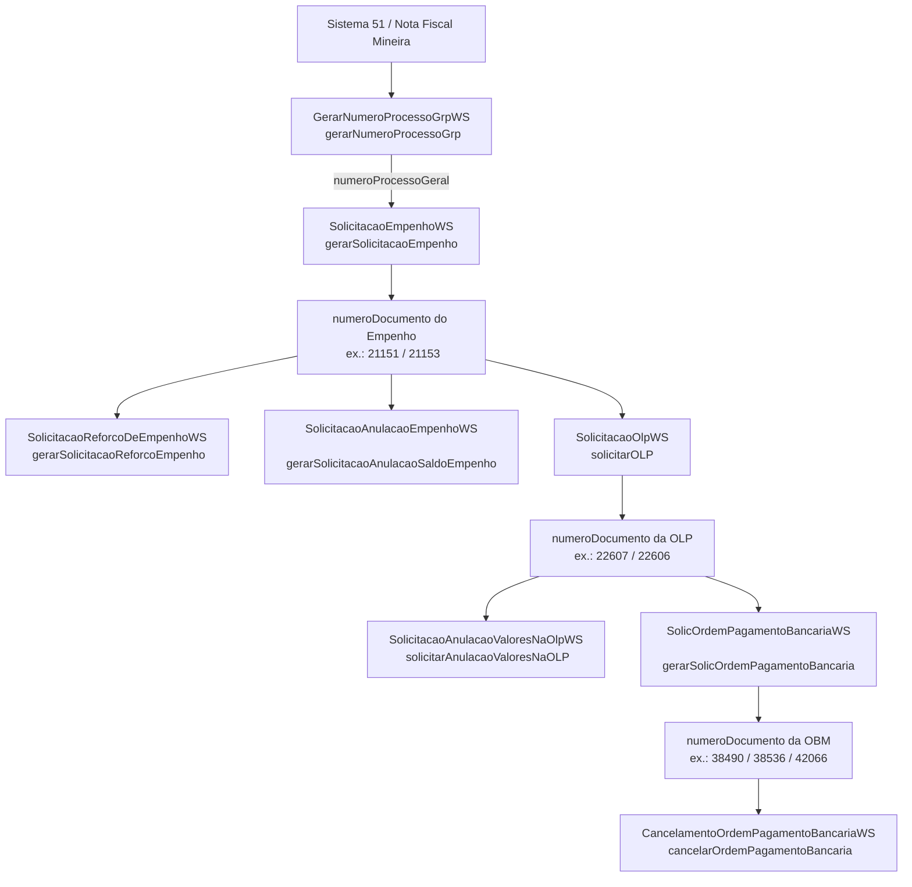

# Documentação de Integração API GRP — Sistema 51 / Nota Fiscal Mineira

<!-- BLOCO:versao:INICIO -->
> **Versão 2.1 — 26/10/2026.** Este documento e o seu par (`manual_api_grp_llm.md` / `docs/DOCUMENTACAO_API_GRP_TESTES_PRIORIDADE_ALTA.md`) têm a mesma versão e não se contradizem: os trechos comuns são gerados de uma fonte só. O histórico de versões está no fim.
<!-- BLOCO:versao:FIM -->

## 1. Visão geral

Esta documentação é a especificação operacional consolidada e a `source of truth` da integração SOAP do GRP-Minas / Prodemge / SEF-MG para o sistema de origem `51 - Nota Fiscal Mineira`.

Tudo o que é necessário para implementar, validar e sustentar a integração do sistema `51` deve ser interpretado a partir deste documento. Regras funcionais, contratos estruturais, exemplos, literais sensíveis, sequências e observações operacionais já estão consolidados aqui e não dependem de consulta paralela a materiais externos.

O escopo coberto inclui o serviço institucional de processo, os serviços principais do fluxo financeiro e os serviços de manutenção validados:

0. Gerar Número de Processo GRP.
1. Gerar Solicitação de Empenho.
2. Gerar Solicitação de Reforço de Empenho.
3. Gerar Solicitação de Anulação de Empenho.
4. Gerar Solicitação de OLP / Liquidação vinculada ao empenho.
5. Gerar Solicitação de Anulação de Valores na OLP.
6. Gerar Solicitação de Ordem de Pagamento Bancária / OBM vinculada à OLP.
7. Gerar Solicitação de Cancelamento de Ordem de Pagamento Bancária.

O padrão tecnológico é baseado em `SOAP 1.1`, contratos `WSDL`, `XML` e transporte `HTTP/HTTPS`.

Os exemplos e regras descritos aqui já refletem a consolidação final dos cenários históricos analisados para o sistema `51`.

A versão 2.0 acrescentou a retenção de IRRF na OP bancária (seção 9.14), o resumo do contrato atual (seção 18.9), a regra do sistema de origem (seção 5.3), a tabela única de erros (seção 15), exemplos por cenário (seção 19.3) e a lista de divergências em verificação (seção 21). A versão 2.1 acrescenta como reproduzir os testes com a árvore interativa (seção 1.1) e as regras práticas de envio (seção 3.10).

### 1.1. Como reproduzir os testes

<!-- BLOCO:arvore:INICIO -->
A **Árvore Interativa da API do GRP** (`arvore_interativa_grp.html`, um arquivo só, que abre em qualquer navegador e funciona sem internet) é a forma recomendada de reproduzir os testes descritos aqui. Para baixá-la: no GitHub, abra o arquivo `arvore_interativa_grp.html` e clique em *Download raw file*.

* **Montar e testar:** a cadeia Processo → Empenho → OLP → OP (com IRRF) e as manutenções (cancelar OP, anular valores na OLP, reforçar e anular empenho). Os dados da execução são informados uma vez; cada etapa leva o número gerado para a seguinte. Os dados ficam só no navegador de quem usa.
* **Conferência antes de enviar:** a página confere as regras desta documentação e os catálogos do GRP embutidos (elemento-item e sistema dono, centros de custo da UA, classificação orçamentária, combinações grupo/fonte/IPU). Os catálogos foram coletados nas datas indicadas e podem estar desatualizados: em caso de divergência, vale o cadastro do GRP, que pode ser consultado nas telas do sistema.
* **Envio:** pela própria página, com um *ajudante de envio* que roda no computador de quem usa (PowerShell com o `curl.exe` do Windows; só aceita a página que o gerou e só fala com o GRP), ou por comandos prontos para PowerShell, curl, Python e Postman/SoapUI. O XML gerado é igual, byte a byte, ao do Assistente GRP (GRP-Tool), que gerou os casos reais.
* **Resposta:** a página lê a resposta do GRP (XML ou JSON), diz se deu certo, o que fazer em caso de erro e mostra o caso real parecido.
* **Casos reais, códigos de resposta, contrato e dicionário:** as mesmas informações desta documentação, com o envio e a resposta de cada caso (CPFs mascarados).

Antes do primeiro envio: rede do Governo ou VPN, sistema de origem autorizado, ordenador com exceção de assinatura e autorizado na UO/UA, programação orçamentária e financeira, credor cadastrado e elemento-item liberado para o sistema (ver pré-requisitos).
<!-- BLOCO:arvore:FIM -->

## 2. Metodologia de consolidação documental

Este documento foi consolidado a partir de validações históricas, contratos técnicos e chamadas reais já analisadas, mas o resultado dessa consolidação passa a valer por si só.

Princípios editoriais adotados:

1. Este documento e o manual `manual_api_grp_llm.md` formam a referência para implementação do sistema `51` e não se contradizem: os trechos comuns (versão, endpoints, sistema de origem, IRRF, erros, divergências, exemplos por cenário e histórico) são gerados de uma fonte só (`core/conteudo_compartilhado.py`).
2. Regras descritas como validadas aqui devem ser implementadas exatamente como estão documentadas.
3. Quando um comportamento é sensível a literal, `CamelCase`, acentuação, padding, cadastro ou saldo, essa sensibilidade é registrada diretamente na seção correspondente.
4. Campos, fluxos ou variantes sem validação explícita permanecem identificados como não consolidados no próprio texto.
5. O apêndice técnico existe apenas como apoio estrutural; ele não substitui as regras operacionais descritas nas seções principais.

## 3. Convenções gerais

### 3.1. SOAP e XML

- `encoding` recomendado: `UTF-8`.
- Envelope SOAP observado nos testes: `http://schemas.xmlsoap.org/soap/envelope/`.
- Os wrappers de operação usam namespace no prefixo `grp`.
- Os elementos internos do payload aparecem sem namespace explícito nos exemplos e isso é compatível com `elementFormDefault="unqualified"` observado nos WSDLs importados.

Exemplo de envelope:

```xml
<?xml version="1.0" encoding="UTF-8"?>
<soap-env:Envelope xmlns:grp="http://interfaces.webservices.empenho.business.grp.prodemge.gov.br/"
                   xmlns:soap-env="http://schemas.xmlsoap.org/soap/envelope/">
  <soap-env:Body>
    <grp:operacao>
      <payload>
        ...
      </payload>
    </grp:operacao>
  </soap-env:Body>
</soap-env:Envelope>
```

### 3.2. Namespaces

- Empenho e OLP, namespace de interface usado no SOAP: `http://interfaces.webservices.empenho.business.grp.prodemge.gov.br/`
- OP Bancária, namespace de interface usado no SOAP: `http://interfaces.webservices.escritural.bancario.pagamento.business.grp.prodemge.gov.br/`

### 3.3. Datas e horários

- O IS costuma descrever datas em formato funcional como `DD/MM/AAAA` ou `dd/mm/aaaa hh:mm:ss`.
- O WSDL tipa campos temporais como `xs:dateTime`.
- Nos testes reais, o formato aceito/retornado foi `ISO-8601`, por exemplo:
  - `2026-06-01T00:00:00`
  - `2026-06-03T15:40:25.740-03:00`
- `Inferência técnica`: para campos `xs:dateTime`, a implementação cliente deve serializar em `ISO-8601`, mesmo quando o IS descreve o formato funcional em linguagem de negócio.

### 3.4. Valores decimais

- Os WSDLs usam `xs:decimal`.
- Nos exemplos reais foi usado separador decimal com ponto, por exemplo `2153.21` e `0.01`.

### 3.5. Identificadores pessoais e cadastrais

- CPF/CNPJ devem ser enviados apenas com dígitos nos exemplos válidos observados.
- Não houve evidência prática de envio com máscara para os requests SOAP aqui documentados.

### 3.6. Sensibilidade de strings

- O backend mostrou sensibilidade a `CamelCase` de tags.
- O backend mostrou sensibilidade a acentuação em valores literais.
- Não há evidência de normalização automática de caixa, acento ou trimming pelo backend.

### 3.7. Zeros à esquerda

- Campos alfanuméricos como `codigoElementoDespesa` e `codigoItem` devem preservar zeros à esquerda, por exemplo `031` e `005`.
- Campos inteiros como `codigoFuncao`, `codigoPrograma`, `codigoSubfuncao` não exigem padding. Os testes mostraram que zeros à esquerda são tolerados, mas não necessários (ex.: `04`/`4`, `045`/`45`, `0001`/`1`, `0243`/`243` foram todos aceitos).

### 3.8. Interpretação de mensagens de retorno

- Todos os códigos de retorno conhecidos, com a mensagem observada, a causa e o tratamento, estão na tabela única da seção 15.
- O `37144` é um código genérico: leia sempre a `descricao`, a causa vem depois de *Causa:* (ver seção 15).
- Mensagens de sucesso não eliminam a necessidade de validar `situacaoSolicitacao`, `numeroDocumento` e `situacaoDocumento`.

### 3.9. Política de mascaramento adotada nesta documentação

- CPF: mascarado.
- CNPJ: mascarado.
- UUID em URL: mascarado.
- URL de documento: mascarada parcialmente.
- `numeroDocumento` e `numeroSolicitacao`: mantidos, conforme orientação do usuário.

### 3.10. Regras práticas de envio

<!-- BLOCO:regras_envio:INICIO -->
* **`numeroRequisicao`:** um número novo por chamada, nunca reaproveitado (nem depois de uma falha). Formato recomendado: data e hora até os segundos (`AAMMDDhhmmss`) seguidas de dígitos sorteados. Na OP, 3 dígitos, 15 no total (ex.: `261027113130482`): aceito em OP em 27/10/2026. Nos demais serviços, 1 dígito, 13 no total (ex.: `2610271131304`), até o teste com 15. Também foram aceitos números de 10 dígitos e de 13 dígitos no formato ano + UO + sequencial (26/10/2026). Números de 17 a 18 dígitos fizeram o GRP recusar todas as OPs (*DataException*, 14/09/2026).
* **Por que data e hora:** o número muda a cada segundo, não se esgota e não exige combinar faixas entre executores. Dois envios só coincidem se saírem no mesmo segundo e sortearem os mesmos dígitos; se acontecer, o GRP recusa o segundo e basta reenviar com outro número. A árvore interativa monta o número assim e, no mesmo navegador, nunca repete um número (cliques no mesmo segundo seguem em sequência).
* **Justificativa sem barra:** uma barra (`/`) na justificativa da OP fez o GRP responder *ArrayIndexOutOfBoundsException* em todas as chamadas (14/09/2026). Troque por hífen (`-`).
* **Sem resposta, o resultado é indeterminado:** quando a chamada termina sem resposta (tempo esgotado ou conexão cortada), a solicitação pode ter sido gravada. Consulte o GRP antes de reenviar, para não gerar documento em dobro; se reenviar, use um número de requisição novo. A árvore mostra esses casos como *resultado indeterminado* e só libera novo envio depois que a pessoa confirma que conferiu no GRP.
<!-- BLOCO:regras_envio:FIM -->

## 4. Matriz geral dos endpoints

Namespaces SOAP de cada serviço: seção 3.2 e a identificação de cada endpoint (seções 6 a 13).

<!-- BLOCO:endpoints:INICIO -->
| Etapa / Operação | Serviço | Operação SOAP | `identificadorProcessoExecucao` | Endpoint (produção) | Situação |
| :--- | :--- | :--- | :--- | :--- | :--- |
| Abertura de processo | `GerarNumeroProcessoGrpWS` | `gerarNumeroProcessoGrp` | — | `https://www.grp.servicos.mg.gov.br/serviceBus/institucional/GerarNumeroProcessoGrpWS` | Validado |
| Empenho | `SolicitacaoEmpenhoWS` | `gerarSolicitacaoEmpenho` | `EMPOLP1.1` | `https://www.grp.servicos.mg.gov.br/serviceBus/empenho/SolicitacaoEmpenhoWS` | Validado |
| Reforço de empenho | `SolicitacaoReforcoDeEmpenhoWS` | `gerarSolicitacaoReforcoEmpenho` | `EMPOLP1.2` | `https://www.grp.servicos.mg.gov.br/serviceBus/empenho/SolicitacaoReforcoDeEmpenhoWS` | Validado em 16/06/2026; estrutura confirmada pelo contrato de 26/10/2026 |
| Anulação de empenho | `SolicitacaoAnulacaoEmpenhoWS` | `gerarSolicitacaoAnulacaoSaldoEmpenho` | `EMPOLP1.3` | `https://www.grp.servicos.mg.gov.br/serviceBus/empenho/SolicitacaoAnulacaoEmpenhoWS` | Validado em 15/06/2026; estrutura confirmada pelo contrato de 26/10/2026 |
| Liquidação (OLP) | `SolicitacaoOlpWS` | `solicitarOLP` | `EMPOLP2.1` | `https://www.grp.servicos.mg.gov.br/serviceBus/empenho/SolicitacaoOlpWS` | Validado |
| Anulação de valores na OLP | `SolicitacaoAnulacaoValoresNaOlpWS` | `solicitarAnulacaoValoresNaOLP` | `EMPOLP2.2` | `https://www.grp.servicos.mg.gov.br/serviceBus/empenho/SolicitacaoAnulacaoValoresNaOlpWS` | Validado em 15/06/2026 |
| OP bancária | `SolicOrdemPagamentoBancariaWS` | `gerarSolicOrdemPagamentoBancaria` | `PGBANESC1.1.1` | `https://www.grp.servicos.mg.gov.br/serviceBus/pagBancarioEEscritural/SolicOrdemPagamentoBancariaWS` | Validado; contrato novo (IRRF no item) na produção desde 19/10/2026 |
| Cancelamento de OP bancária | `CancelamentoOrdemPagamentoBancariaWS` | `cancelarOrdemPagamentoBancaria` | `PGBANESC1.2.1` | `https://www.grp.servicos.mg.gov.br/serviceBus/pagBancarioEEscritural/CancelamentoOrdemPagamentoBancariaWS` | Validado em 15/06 e 13/10/2026 |

* **Produção:** `https://www.grp.servicos.mg.gov.br/serviceBus/...`. Sem o `www`, o servidor responde `301` para o endereço com `www`; se o cliente seguir o redirecionamento sozinho, o `POST` vira `GET` e o conteúdo se perde. Use o endereço com `www` ou reenvie o `POST` ao endereço do `Location`.
* **Desenvolvimento (PRODEMGE):** `https://desenvolvimento.grp.servicos.mg.gov.br/serviceBus/...`. Publica os contratos (`?wsdl`) e recebe primeiro as mudanças de contrato (o IRRF no item apareceu lá em 14/10/2026). Não use para gerar documentos sem autorização da PRODEMGE: os dados são outros.
* **Contratos WSDL:** conferidos em 26/10/2026 — produção e desenvolvimento publicam o contrato dos 8 serviços (HTTP 200), com os mesmos campos nos dois ambientes; cada contrato declara o próprio endereço (`www` na produção). Resumos em `contratos/producao/2026-10-26/RESUMO.md` e `contratos/desenvolvimento/2026-10-26/RESUMO.md`. Até 16/10/2026 o `?wsdl` da produção redirecionava para `indisponivel.mg.gov.br`. Para baixar de novo e conferir os 8 endereços, rode na rede do Governo ou na VPN `python scripts/baixar_contratos_wsdl.py`: ele só faz `GET`, salva os arquivos em `contratos/<ambiente>/<data>/` e gera um `RESUMO.md` com a situação de cada endpoint e os campos de cada tipo.
* **Rede:** o GRP só responde de dentro da rede do Governo de Minas ou pela VPN. Em algumas máquinas, a borda da PRODEMGE devolve a página de indisponibilidade para o TLS do Python (OpenSSL) e aceita o `curl.exe` do Windows; nesses casos, use o `curl.exe` como transporte (sem imitar navegador).
* **Ambiente atual:** segundo a SEF (15/10/2026), a instalação do GRP em `www.grp.servicos` é de teste: as OPs geradas lá não seguem para os bancos.
* **Fora da API para o sistema 51:** a consulta IS47588 (recuperar dados da execução da despesa) não aceita `codigoSistemaSolicitante` 51. Conferir OPs só pela tela de consulta do GRP, pelo Nº da solicitação.
<!-- BLOCO:endpoints:FIM -->

## 5. Fluxo ponta a ponta da integração

### 5.1. Fluxo funcional

Fluxo canônico:

0. A Geração de Número de Processo GRP cria um número institucional (ex: `101901800000001202611`) para o sistema origem.
1. A Solicitação de Empenho utiliza o número de processo e gera `numeroDocumento` do empenho.
2. A Solicitação de OLP usa `numeroDocumentoEmpenho` para liquidar o empenho e gerar `numeroDocumento` da OLP.
3. A Solicitação de Ordem de Pagamento Bancária usa a OLP previamente gerada nos itens de pagamento para gerar a OBM/OP.
4. A Solicitação de Cancelamento de Ordem de Pagamento Bancária pode ser usada sobre OP previamente gerada, desde que o identificador de processo e o documento sejam aceitos pelo backend.

Fluxos laterais de manutenção:

1. A Solicitação de Reforço de Empenho pode ser usada sobre empenho previamente gerado, desde que o tipo e a programação permitam o reforço.
2. A Solicitação de Anulação de Empenho pode ser usada sobre empenho previamente gerado, abrindo um fluxo de tramitação de anulação.
3. A Solicitação de Anulação de Valores na OLP pode ser usada sobre OLP previamente gerada, abrindo um fluxo de tramitação de anulação.

### 5.2. Diagrama Mermaid



### 5.3. Regra do sistema de origem

<!-- BLOCO:sistema_origem:INICIO -->
* **Mesmo sistema em toda a cadeia:** processo, empenho, OLP, OP e as operações de manutenção de uma mesma execução devem usar o mesmo `codigoSistemaOrigem` (no processo, `codigoSistemaSolicitante`). Só o próprio GRP, pela interface web, opera documentos de qualquer origem.
* **Documentos registrados pela tela do GRP** podem continuar pela API: não é preciso fazer todas as etapas pela API. Exemplo testado: OP enviada pela API sobre uma OLP registrada na tela do GRP.
* **Evidência (15/10/2026):** uma OP enviada com sistema `2` (Portal de Compras) sobre uma OLP criada pelo sistema `51` voltou `62229` — *"Documento não permitido, a solicitação deve ser registrada via NOTA MINEIRA"*.
* **Portal de Compras (sistema `2`):** é um sistema que só empenha e liquida. A OP de documentos do Portal de Compras é feita pela interface do GRP, inclusive quando a execução inteira começou do zero com o sistema `2`.
* **Não troque de sistema por conta própria:** usar o código de outro sistema exige autorização da PRODEMGE/STE. O sistema `51` é a Nota Fiscal Mineira.
<!-- BLOCO:sistema_origem:FIM -->

## 6. Endpoint 0 — Geração de Número de Processo GRP

### 6.1. Identificação

- Nome funcional: Geração de Número de Processo GRP.
- Serviço WSDL: `GerarNumeroProcessoGrpWS`.
- Endpoint WSDL: `https://www.grp.servicos.mg.gov.br/serviceBus/institucional/GerarNumeroProcessoGrpWS?wsdl`.
- Operação SOAP: `gerarNumeroProcessoGrp`.
- Namespace SOAP: `http://interfaces.webservices.institucional.business.grp.prodemge.gov.br/`.
- Sistema origem utilizado nos testes: `51 - Nota Fiscal Mineira`.

### 6.2. Finalidade

Gerar um novo número de processo GRP válido e autêntico no banco de dados institucional para posterior uso no campo `numeroProcessoGeral` da solicitação de empenho.

### 6.3. Contrato técnico

Estrutura SOAP observada:

```xml
<int:gerarNumeroProcessoGrp>
  <anoExercicio>...</anoExercicio>
  <codigoOrgao>...</codigoOrgao>
  <codigoProcessoDeNegocio>...</codigoProcessoDeNegocio>
  <codigoUnidadeAdministrativa>...</codigoUnidadeAdministrativa>
  <codigoUnidadeOrcamentaria>...</codigoUnidadeOrcamentaria>
  <codigoSistemaSolicitante>...</codigoSistemaSolicitante>
</int:gerarNumeroProcessoGrp>
```

Resumo contratual:

- Wrapper de request e operação fundidos: `gerarNumeroProcessoGrp` atrelado ao namespace institucional.
- Wrapper de response: `gerarNumeroProcessoGrpResponse`.
- Resposta principal: número em formato string diretamente na tag `<return>`.

### 6.4. Campos obrigatórios neste fluxo

Campos-base obrigatórios validados no teste prático:

- `anoExercicio`: Ano corrente (ex: `2026`).
- `codigoOrgao`: Órgão executor (ex: `10190`).
- `codigoProcessoDeNegocio`: `18` (orientação para despesa com característica OUTROS).
- `codigoUnidadeAdministrativa`: UA (ex: `1019080124`).
- `codigoUnidadeOrcamentaria`: UO (ex: `10191`).
- `codigoSistemaSolicitante`: Sistema origem (ex: `51`).

### 6.5. Exemplo de request validado

```xml
<?xml version="1.0" encoding="utf-8"?>
<soapenv:Envelope xmlns:soapenv="http://schemas.xmlsoap.org/soap/envelope/"
                  xmlns:int="http://interfaces.webservices.institucional.business.grp.prodemge.gov.br/">
  <soapenv:Header/>
  <soapenv:Body>
    <int:gerarNumeroProcessoGrp>
      <anoExercicio>2026</anoExercicio>
      <codigoOrgao>10190</codigoOrgao>
      <codigoProcessoDeNegocio>18</codigoProcessoDeNegocio>
      <codigoUnidadeAdministrativa>1019080124</codigoUnidadeAdministrativa>
      <codigoUnidadeOrcamentaria>10191</codigoUnidadeOrcamentaria>
      <codigoSistemaSolicitante>51</codigoSistemaSolicitante>
    </int:gerarNumeroProcessoGrp>
  </soapenv:Body>
</soapenv:Envelope>
```

### 6.6. Exemplo de response validado

```json
{
  "return": "101901800000001202611"
}
```

Retorno SOAP Bruto:

```xml
<soap:Envelope xmlns:soap="http://schemas.xmlsoap.org/soap/envelope/">
  <soap:Body>
    <ns2:gerarNumeroProcessoGrpResponse xmlns:ns2="http://interfaces.webservices.institucional.business.grp.prodemge.gov.br/">
      <return>101901800000001202611</return>
    </ns2:gerarNumeroProcessoGrpResponse>
  </soap:Body>
</soap:Envelope>
```

### 6.7. Regras críticas observadas em teste

1. O nome da operação `int:gerarNumeroProcessoGrp` age como wrapper, sem objeto interno.
2. O `codigoProcessoDeNegocio = 18` é requerido para este contexto de integração.
3. Diferente dos demais endpoints do GRP validados (que retornam blocos de mensagens de sucesso), este endpoint é puramente síncrono e devolve apenas o número do processo (ou erro) na tag `<return>`.


## 7. Endpoint 1 — Solicitação de Empenho

### 7.1. Identificação

- Nome funcional: Solicitação de Empenho.
- Serviço WSDL: `SolicitacaoEmpenhoWS`.
- Endpoint WSDL: `https://www.grp.servicos.mg.gov.br/serviceBus/empenho/SolicitacaoEmpenhoWS?wsdl`.
- Operação SOAP: `gerarSolicitacaoEmpenho`.
- Namespace SOAP usado nos exemplos: `http://interfaces.webservices.empenho.business.grp.prodemge.gov.br/`.
- `targetNamespace` do WSDL raiz consultado: `http://soap.webservices.empenho.business.grpsrv.prodemge.gov.br/`.
- `identificadorProcessoExecucao`: `EMPOLP1.1`.
- Sistema origem utilizado nos testes: `51 - Nota Fiscal Mineira`.

### 7.2. Finalidade

Gerar uma solicitação de empenho no GRP para o sistema origem `51`, com a classificação orçamentária enviada no bloco `olpPendenteCreditoNaoRegularizar`.

### 7.3. Contrato técnico

Estrutura SOAP observada:

```xml
<grp:gerarSolicitacaoEmpenho>
  <solicitacaoEmpenho>
    ...campos principais...
    <olpPendenteCreditoNaoRegularizar>
      ...classificação orçamentária...
    </olpPendenteCreditoNaoRegularizar>
  </solicitacaoEmpenho>
</grp:gerarSolicitacaoEmpenho>
```

Resumo contratual:

- Wrapper de request: `gerarSolicitacaoEmpenho`.
- Objeto request principal: `gerarSolicitacaoEmpenhoRequest`, serializado como `solicitacaoEmpenho`.
- Wrapper de response: `gerarSolicitacaoEmpenhoResponse`.
- Objeto response principal: `GeracaoSolicitacaoEmpenhoResponse`, retornado em `return`.
- Blocos internos principais:
  - `olpPendenteCreditoNaoRegularizar`
  - `olpPendenteCreditoregularizar`
  - `anexos/anexo`

### 7.4. Campos obrigatórios neste fluxo

Campos-base obrigatórios relevantes para o cenário documentado:

- `numeroRequisicao`
- `identificadorProcessoExecucao`
- `codigoSistemaOrigem`
- `anoExercicioFinanceiro`
- `codigoUnidadeOrcamentaria`
- `codigoOrgaoExecutor`
- `codigoUnidadeAdministrativa`
- `cpfOrdenadorDespesa`
- `justificativa`
- `tipoEmpenhoComum`

Campos obrigatórios do bloco orçamentário principal neste fluxo:

- `classificacaoCredor`
- `codigoFuncao`
- `codigoSubfuncao`
- `codigoPrograma`
- `codigoProjetoAtividade`
- `codigoSubprojetoSubatividade`
- `codigoCategoriaEconomica`
- `codigoGrupoDespesa`
- `codigoModalidadeDespesa`
- `codigoElementoDespesa`
- `codigoItem`
- `codigoIag`
- `codigoGrupoFonte`
- `codigoFonteRecurso`
- `codigoIpu`
- `valorEmpenho`
- `codigoCc`

### 7.5. Campos condicionais

Campos condicionais relevantes neste fluxo:

- `numeroArquivo`, `sistemaOrigemArquivo`, `identificadorTipoDespesaPessoal`: obrigatórios para cenários de despesa de pessoal.
- `mesReferencia`, `anoReferencia`: obrigatórios quando o elemento-item permitir provisão de folha.
- `regularizarOlp`: obrigatório se o empenho for para regularizar OLP sem empenho no cenário de despesa de pessoal.
- `numeroRecebimentoProvisorio`, `anoRecebimentoProvisorio`: obrigatórios quando `indicadorReconhecimentoPassivo = SIM`.
- `codigoElementoDea`, `codigoItemDea`, `numeroAutorizacaoDea`: obrigatórios em cenários DEA.
- instrumentos jurídicos, `codigoUfg`, `numeroObra`, `codigoTipoTribunal`, `numeroProcessoCompra`, `codigoProcedimentoContratacao`, `numeroImovel`: dependem da parametrização da natureza/item e do sistema predominante.

### 7.6. Blocos internos

#### 7.6.1. `olpPendenteCreditoNaoRegularizar`

Bloco central da integração do sistema `51` nos testes reais. Apesar de o WSDL marcar o bloco com `minOccurs="0"`, os testes mostraram obrigatoriedade prática para o cenário validado.

Campos críticos observados no request validado:

- `indicadorReconhecimentoPassivo`
- `cpfOperador`
- `numeroProcessoGeral`
- `cpfCnpjCredor`
- `classificacaoCredor`
- classificação orçamentária completa
- `valorEmpenho`
- `codigoCc`

#### 7.6.2. `anexos`

- Permitidos contratualmente neste serviço.
- Formatos documentados: `PDF`, `XML`, `JPEG`, `PNG`, `GIF`, `PKCS7_SIGNATURE`.
- Limite documentado: até 5 anexos, até 1 MB por anexo.

### 7.7. Exemplo de request validado

```xml
<?xml version="1.0" encoding="utf-8"?>
<soap-env:Envelope xmlns:grp="http://interfaces.webservices.empenho.business.grp.prodemge.gov.br/"
                   xmlns:soap-env="http://schemas.xmlsoap.org/soap/envelope/">
  <soap-env:Body>
    <grp:gerarSolicitacaoEmpenho>
      <solicitacaoEmpenho>
        <numeroRequisicao>1779980842</numeroRequisicao>
        <identificadorProcessoExecucao>EMPOLP1.1</identificadorProcessoExecucao>
        <codigoSistemaOrigem>51</codigoSistemaOrigem>
        <anoExercicioFinanceiro>2026</anoExercicioFinanceiro>
        <codigoUnidadeOrcamentaria>10191</codigoUnidadeOrcamentaria>
        <codigoOrgaoExecutor>10190</codigoOrgaoExecutor>
        <codigoUnidadeAdministrativa>1019080124</codigoUnidadeAdministrativa>
        <cpfOrdenadorDespesa>***MASCARADO***</cpfOrdenadorDespesa>
        <justificativa>TESTE NOTA FISCAL MINEIRA</justificativa>
        <tipoEmpenhoComum>ORDINARIO</tipoEmpenhoComum>
        <olpPendenteCreditoNaoRegularizar>
          <indicadorReconhecimentoPassivo>NAO</indicadorReconhecimentoPassivo>
          <cpfOperador>***MASCARADO***</cpfOperador>
          <numeroProcessoGeral>111111111111111111111</numeroProcessoGeral>
          <cpfCnpjCredor>***MASCARADO***</cpfCnpjCredor>
          <classificacaoCredor>SERVIDOR PUBLICO ESTADUAL</classificacaoCredor>
          <codigoFuncao>4</codigoFuncao>
          <codigoSubfuncao>129</codigoSubfuncao>
          <codigoPrograma>45</codigoPrograma>
          <codigoProjetoAtividade>4081</codigoProjetoAtividade>
          <codigoSubprojetoSubatividade>1</codigoSubprojetoSubatividade>
          <codigoCategoriaEconomica>3</codigoCategoriaEconomica>
          <codigoGrupoDespesa>3</codigoGrupoDespesa>
          <codigoModalidadeDespesa>90</codigoModalidadeDespesa>
          <codigoElementoDespesa>031</codigoElementoDespesa>
          <codigoItem>005</codigoItem>
          <codigoIag>0</codigoIag>
          <codigoGrupoFonte>11</codigoGrupoFonte>
          <codigoFonteRecurso>500010</codigoFonteRecurso>
          <codigoIpu>1</codigoIpu>
          <valorEmpenho>2153.21</valorEmpenho>
          <codigoCc>243</codigoCc>
        </olpPendenteCreditoNaoRegularizar>
      </solicitacaoEmpenho>
    </grp:gerarSolicitacaoEmpenho>
  </soap-env:Body>
</soap-env:Envelope>
```

### 7.8. Exemplo de response validado

```json
{
  "numeroRequisicao": "1779980842",
  "codigoSistemaOrigem": "51",
  "anoExercicioFinanceiro": "2026",
  "numeroSolicitacao": "21270",
  "situacaoSolicitacao": "Concluída",
  "numeroDocumento": "21151",
  "situacaoDocumento": "Registrado e pendente de assinatura",
  "urlDocumento": "https://www.grp.servicos.mg.gov.br/grp-srv-rs/rest/serviceBus/documento/***MASCARADO***/***UUID-MASCARADO***",
  "dataSolicitacao": "2026-05-28T12:07:25.528-03:00",
  "mensagens": [
    {
      "codigo": "41040",
      "descricao": "Solicitação Empenho gerado com sucesso!"
    }
  ]
}
```

### 7.9. Regras críticas observadas em teste

1. `olpPendenteCreditoNaoRegularizar` foi obrigatório na prática para o sistema origem `51`.
2. `classificacaoCredor` deve ser coerente com a natureza do CPF/CNPJ. No empenho foram aceitas as formas sem acento (`SERVIDOR PUBLICO ESTADUAL`) e com acento (`BENEFICIÁRIOS DIVERSOS`, matriz de 64 cenários); na OLP e na OP, só com acento.
3. A combinação `UA + classificação orçamentária + codigoCc` precisa possuir saldo orçamentário/disponibilidade aprovada.
4. `codigoCc = 243` foi explicitamente validado com sucesso nos testes.
5. `cpfOrdenadorDespesa` não pode ser igual a `cpfCnpjCredor`.
6. Zeros à esquerda não são necessários para campos inteiros.
7. Zeros à esquerda devem ser preservados em campos alfanuméricos como `codigoElementoDespesa` e `codigoItem`.

### 7.10. Códigos de retorno e troubleshooting

| Código | Base | Interpretação | Ação recomendada |
|---|---|---|---|
| `30782` | Comportamento consolidado | Formato da requisição inválido | Validar XML, wrappers e tipos básicos |
| `25081` | Comportamento consolidado | Campo obrigatório ausente | Validar obrigatoriedade funcional e blocos condicionais |
| `41040` | Comportamento consolidado | Solicitação gerada com sucesso | Persistir `numeroSolicitacao` e `numeroDocumento` |

### 7.11. Matriz de compatibilidade e comportamento validado

| Campo / Bloco / Regra | Contrato estrutural | Comportamento validado | Status | Recomendação para implementação |
|---|---|---|---|---|
| `olpPendenteCreditoNaoRegularizar` | `minOccurs=0` | Omissão causa rejeição para sistema `51` | obrigatório na prática | Tratar como obrigatório para o sistema `51` |
| `classificacaoCredor` | `xs:string`, obrigatório no bloco | Funcionou com `SERVIDOR PUBLICO ESTADUAL` | consistente | Enviar literal coerente com o cadastro do credor |
| `codigoCc` | Obrigatório (`xs:long`) | `243` validado com sucesso | consistente | Validar saldo/programação orçamentária antes do envio |
| `codigoFuncao`, `codigoPrograma` etc. | `xs:long` | Zeros à esquerda tolerados | opcional na prática | Enviar sem padding por clareza operacional |
| `codigoElementoDespesa`, `codigoItem` | `xs:string` | Exigiram preservação de `031` / `005` | valor literal sensível | Preservar zeros à esquerda |
| `cpfOrdenadorDespesa != cpfCnpjCredor` | Sem restrição tipada no contrato | Rejeição quando iguais | requer cadastro/saldo/permissão | Validar antes da chamada |

### 7.12. Observação crítica consolidada

#### Bloco `olpPendenteCreditoNaoRegularizar`

1. O contrato estrutural marca o grupo como opcional (`minOccurs=0`).
2. No comportamento validado do sistema `51`, o bloco foi estritamente necessário.
3. Recomendação prática: para `codigoSistemaOrigem = 51`, implementar este bloco como obrigatório operacional.

## 8. Endpoint 2 — Solicitação de OLP

### 8.1. Identificação

- Nome funcional: Solicitação de OLP.
- Serviço WSDL: `SolicitacaoOlpWS`.
- Endpoint WSDL: `https://www.grp.servicos.mg.gov.br/serviceBus/empenho/SolicitacaoOlpWS?wsdl`.
- Operação SOAP: `solicitarOLP`.
- Namespace SOAP usado nos exemplos: `http://interfaces.webservices.empenho.business.grp.prodemge.gov.br/`.
- `targetNamespace` do WSDL raiz consultado: `http://soap.webservices.empenho.business.grpsrv.prodemge.gov.br/`.
- `identificadorProcessoExecucao`: `EMPOLP2.1`.
- Sistema origem utilizado nos testes: `51 - Nota Fiscal Mineira`.

### 8.2. Finalidade

Gerar a OLP vinculada ao empenho previamente gerado, efetivando a liquidação no fluxo validado para o sistema `51`.

### 8.3. Contrato técnico

Estrutura SOAP observada:

```xml
<grp:solicitarOLP>
  <solicitacaoOlp>
    ...campos principais...
    <OlpDeEmpenho>
      ...
    </OlpDeEmpenho>
    <ValoresDaOlp>
      ...
    </ValoresDaOlp>
  </solicitacaoOlp>
</grp:solicitarOLP>
```

Resumo contratual:

- Wrapper de request: `solicitarOLP`.
- Objeto request principal: `solicitacaoOlpRequest`, serializado como `solicitacaoOlp`.
- Wrapper de response: `solicitarOLPResponse`.
- Response principal: `solicitacaoOLPResponse`, retornado em `return`.
- Seções do contrato:
  - `OlpDeRpnp`
  - `OlpDeEmpenho`
  - `OlpSemEmpenho`
  - `ValoresDaOlp`
  - `notaFiscalOlpRequestList`
  - `retencaoOlpRequestList`
  - `regionalizacaoDespesaOlpRequestList`
  - `anexosRequestList`

### 8.4. Campos obrigatórios neste fluxo

- `numeroRequisicao`
- `identificadorProcessoExecucao`
- `codigoSistemaOrigem`
- `anoExercicioFinanceiro`
- `codigoUnidadeOrcamentaria`
- `codigoOrgaoExecutor`
- `codigoUnidadeAdministrativa`
- `cpfOrdenadorDespesa`
- `mesCompetenciaDespesa`
- `anoCompetenciaDespesa`
- `justificativa`
- `valorBrutoOlp`

### 8.5. Campos condicionais

Campos condicionais relevantes neste fluxo:

- `numeroProcessoGeral`
- `numeroArquivo`
- `codigoSistemaOrigemArquivo`
- `identificadorTipoFolha`
- `codigoReceitaDaOlp`
- `cpfOperador`
- `dataPagamentoOlp`
- `numeroEspecificacaoOlp`
- `codigoUoBeneficiariaOlp`
- retenções
- nota fiscal
- regionalização
- anexos

### 8.6. Seções / blocos da OLP

#### 8.6.1. `OlpDeEmpenho`

Usado com sucesso nos testes do sistema `51`.

Campos observados:

- `numeroDocumentoEmpenho`
- `cpfCredorBeneficiario`
- `tipoClassificacaoCredor`

#### 8.6.2. `OlpDeRpnp`

Variante prevista contratualmente para liquidação de restos a pagar não processados. Não há caso consolidado de sucesso nesta documentação.

#### 8.6.3. `OlpSemEmpenho`

Variante prevista contratualmente. Não há caso validado consolidado nesta documentação para o sistema `51`.

#### 8.6.4. `ValoresDaOlp`

Bloco obrigatório no WSDL.

Campos:

- `valorBrutoOlp`
- `valorLiquido`
- `valorMultaContratual`
- `valorRetencaoOlp`

#### 8.6.5. `Retenções`

- O IS descreve a seção de entrada como opcional.
- O IS também descreve retenções no retorno como obrigatórias quando a solicitação concluída possuir retenção.
- O WSDL prevê lista `retencaoOlpRequestList` no request e `retencaoResponseList` no response.
- Códigos validados (matriz de 64 cenários): INSS `14` (aceito com credor CPF e CNPJ; `4` também aceito com credor CPF) e ISSQN `13`. O credor da retenção vai em `cpfCapfCredorRetencao` (grafia do contrato).
- O IRRF não é retido na OLP: ele é inscrito na OP (seção 9.14).

#### 8.6.6. `Nota Fiscal`

- O IS condiciona o preenchimento à exigência do elemento-item.
- O WSDL prevê `notaFiscalOlpRequestList`.
- Não houve nota fiscal utilizada nos exemplos bem-sucedidos do sistema `51` fornecidos.

#### 8.6.7. `Anexos`

- Permitidos contratualmente neste serviço.
- Mesmo padrão documental de formatos e limites observado nos demais serviços.

### 8.7. Exemplo de request validado

```xml
<?xml version="1.0" encoding="utf-8"?>
<soap-env:Envelope xmlns:grp="http://interfaces.webservices.empenho.business.grp.prodemge.gov.br/"
                   xmlns:soap-env="http://schemas.xmlsoap.org/soap/envelope/">
  <soap-env:Body>
    <grp:solicitarOLP>
      <solicitacaoOlp>
        <numeroRequisicao>1780321292</numeroRequisicao>
        <identificadorProcessoExecucao>EMPOLP2.1</identificadorProcessoExecucao>
        <codigoSistemaOrigem>51</codigoSistemaOrigem>
        <anoExercicioFinanceiro>2026</anoExercicioFinanceiro>
        <codigoUnidadeOrcamentaria>10191</codigoUnidadeOrcamentaria>
        <codigoOrgaoExecutor>10190</codigoOrgaoExecutor>
        <codigoUnidadeAdministrativa>1019080124</codigoUnidadeAdministrativa>
        <cpfOrdenadorDespesa>***MASCARADO***</cpfOrdenadorDespesa>
        <cpfOperador>***MASCARADO***</cpfOperador>
        <mesCompetenciaDespesa>5</mesCompetenciaDespesa>
        <anoCompetenciaDespesa>2026</anoCompetenciaDespesa>
        <justificativa>TESTE LIQUIDACAO EMPENHO NOTA FISCAL MINEIRA</justificativa>
        <OlpDeEmpenho>
          <numeroDocumentoEmpenho>21151</numeroDocumentoEmpenho>
          <cpfCredorBeneficiario>***MASCARADO***</cpfCredorBeneficiario>
          <tipoClassificacaoCredor>SERVIDOR PÚBLICO ESTADUAL</tipoClassificacaoCredor>
        </OlpDeEmpenho>
        <ValoresDaOlp>
          <valorBrutoOlp>2153.21</valorBrutoOlp>
          <valorLiquido>2153.21</valorLiquido>
        </ValoresDaOlp>
      </solicitacaoOlp>
    </grp:solicitarOLP>
  </soap-env:Body>
</soap-env:Envelope>
```

### 8.8. Exemplo de response validado

```json
{
  "numeroRequisicao": "1780321292",
  "codigoSistemaOrigem": "51",
  "anoExercicioFinanceiro": "2026",
  "numeroSolicitacaoOlp": "22660",
  "situacaoSolicitacao": "Concluída",
  "numeroDocumento": "22607",
  "situacaoDocumento": "Registrado e pendente de assinatura",
  "urlDocumento": "https://www.grp.servicos.mg.gov.br/grp-srv-rs/rest/serviceBus/documento/***MASCARADO***/***UUID-MASCARADO***",
  "dataSolicitacao": "2026-06-01T10:41:34.205-03:00",
  "mensagens": [
    {
      "codigo": "41040",
      "descricao": "Solicitação 22660 gerado com sucesso!"
    }
  ]
}
```

### 8.9. Regras críticas observadas em teste

1. `numeroDocumentoEmpenho` precisa existir previamente.
2. `OlpDeEmpenho` exige `CamelCase` exato.
3. `ValoresDaOlp` exige `CamelCase` exato.
4. `valorLiquido` foi obrigatório na prática, apesar de opcional no IS/WSDL.
5. `valorLiquido` deve ser matematicamente compatível com `valorBrutoOlp` e retenções.
6. `tipoClassificacaoCredor`, apesar de documentado como inteiro em trechos do IS, funcionou na prática com string literal acentuada `SERVIDOR PÚBLICO ESTADUAL`.
7. O backend aparentemente não normaliza acentos, caixa ou strings.

### 8.10. Códigos de retorno e troubleshooting

| Código | Base | Interpretação | Ação recomendada |
|---|---|---|---|
| `30782` | Comportamento consolidado | Formato da requisição inválido | Validar wrappers, `CamelCase` e XML |
| `25081` | Comportamento consolidado | Campo obrigatório ausente | Revisar obrigatoriedade funcional e regra do sistema `51` |
| `41040` | Comportamento consolidado | Solicitação gerada com sucesso | Persistir `numeroSolicitacaoOlp` e `numeroDocumento` |

### 8.11. Matriz de compatibilidade e comportamento validado

| Campo / Bloco / Regra | Contrato estrutural | Comportamento validado | Status | Recomendação para implementação |
|---|---|---|---|---|
| `OlpDeEmpenho` | `minOccurs=0` | Usado com sucesso e essencial no cenário | consistente | Usar para liquidar empenho já gerado |
| `ValoresDaOlp` | Obrigatório | Obrigatório de fato | consistente | Sempre enviar |
| `valorLiquido` | `minOccurs=0` | Obrigatório no cenário validado | obrigatório na prática | Sempre enviar para sistema `51` |
| `tipoClassificacaoCredor` | `xs:string` | Aceitou string acentuada | tipo divergente | Implementar como string literal validada |
| `OlpDeEmpenho` / `ValoresDaOlp` `CamelCase` | Nomes exatos no contrato | Erro de unmarshalling quando fora do caso | requer CamelCase exato | Não alterar caixa das tags |
| Acentuação de classificação | `xs:string` | `SERVIDOR PÚBLICO ESTADUAL` funcionou; sem acento rejeitado | requer acentuação | Tratar como literal sensível |

### 8.12. Observações críticas consolidadas

#### Campo `tipoClassificacaoCredor`

1. O contrato estrutural define o campo como `xs:string`.
2. No comportamento validado, valores inteiros foram rejeitados; a chamada só concluiu com `SERVIDOR PÚBLICO ESTADUAL`.
3. Recomendação prática: para o sistema `51`, implementar como string literal acentuada e validar o valor antes do envio.

#### Campo `valorLiquido`

1. O contrato estrutural o define com `minOccurs=0`.
2. No comportamento validado, sua omissão bloqueou a liquidação.
3. Recomendação prática: tratar `valorLiquido` como obrigatório operacional no fluxo do sistema `51`.

## 9. Endpoint 3 — Solicitação de Ordem de Pagamento Bancária / OBM

### 9.1. Identificação

- Nome funcional: Solicitação de Ordem de Pagamento Bancária / OBM.
- Serviço WSDL: `SolicOrdemPagamentoBancariaWS`.
- Endpoint WSDL: `https://www.grp.servicos.mg.gov.br/serviceBus/pagBancarioEEscritural/SolicOrdemPagamentoBancariaWS?wsdl`.
- Operação SOAP: `gerarSolicOrdemPagamentoBancaria`.
- Namespace SOAP usado nos exemplos: `http://interfaces.webservices.escritural.bancario.pagamento.business.grp.prodemge.gov.br/`.
- `targetNamespace` do WSDL raiz consultado: `http://soap.webservices.escritural.bancario.pagamento.business.grpsrv.prodemge.gov.br/`.
- `identificadorProcessoExecucao` usado nos testes: `PGBANESC1.1.1`.
- Sistema origem utilizado nos testes: `51 - Nota Fiscal Mineira`.

### 9.2. Finalidade

Gerar solicitação de ordem de pagamento do subtipo bancária, vinculando o pagamento à OLP previamente gerada. O IS também cobre subtipos escritural, quitação e off-line, mas a evidência prática aqui validada é do subtipo bancária.

### 9.3. Contrato técnico

- Operação: `gerarSolicOrdemPagamentoBancaria`.
- Request wrapper: `solicitacaoOrdemPagamentoBancaria`.
- Tipo principal: `solicitacaoOrdemPagamentoBancariaRequest`.
- Response wrapper: `gerarSolicOrdemPagamentoBancariaResponse`.
- Tipo de retorno: `SolicitacaoOrdemPagamentoBancariaResponse`.

Estrutura principal:

```xml
<grp:gerarSolicOrdemPagamentoBancaria>
  <solicitacaoOrdemPagamentoBancaria>
    ...campos principais...
    <itemDePagamentoList>
      <ItemDePagamento>
        ...
      </ItemDePagamento>
    </itemDePagamentoList>
  </solicitacaoOrdemPagamentoBancaria>
</grp:gerarSolicOrdemPagamentoBancaria>
```

### 9.4. Campos obrigatórios neste fluxo

- `numeroRequisicao`
- `identificadorProcessoExecucao`
- `codigoSistemaOrigem`
- `anoExercicioFinanceiro`
- `codigoUnidadeOrcamentaria`
- `codigoOrgaoExecutor`
- `codigoUnidadeAdministrativa`
- `cpfOrdenadorDespesa`
- `cpfOperador`
- `cpfCnpjCredor`
- `classificacaoCredor`
- `origemPagamento`
- `cpfCnpjCredorOP`
- `classificacaoCredorDaOP`
- `codigoFormaPagamento`
- `valorTotalAPagarDaOP`
- `valorLiquidoPagamento`
- `justificativa`

### 9.5. Campos condicionais

Campos condicionais deste fluxo:

- `numeroArquivo`
- `codigoUnidadeOrcamentariaBeneficiadaCredor`
- `tipoDeRetencao`
- `anoDepositoVinculado`
- `tipoDeDepositoVinculado`
- `tipoDePagamento`
- `tipodeTribunal`
- `anoDoPrecatorio`
- `naturezaDoPrecatorio`
- `numeroDoPrecatorio`
- `tipoContaADebitar`
- dados bancários a debitar
- dados bancários a creditar
- `codigoBarras`
- `darf`
- `guiaPrevidenciaEstadualGpe`
- `finalidadePagamento`: obrigatória (erro `38727`) com `tipoContaADebitar = 2` ou `codigoFormaPagamento = 002`; o GRP aceitou qualquer texto (ex.: `01`, `Não se aplica`).
- `codigoBarras`: obrigatório com `codigoFormaPagamento = 002` (código de barras), sem conta a creditar.
- `anexosRequestList`
- encargos financeiros (`encargoFinanceiro`, dentro do item de pagamento)

Fora do contrato atual (não usar em implementações novas; aparecem só em casos históricos):

- `retencaoList`: o GRP a ignorava (nada era retido) e ela saiu do contrato novo; INSS/ISSQN ficam na OLP e o IRRF vai no item (seção 9.14).
- `guiaPrevidenciaSocialGps`: removida no contrato novo (seção 9.7).

### 9.6. Itens de pagamento

Bloco detalhado no IS e no WSDL:

- `itemDePagamentoList`
- `ItemDePagamento`
- `itemDePagamento`
- `anoNumeroDaOlpEEmpenho`
- `valorAPagar`
- `valorTotalAPagar`
- `valorLiquido`
- `retencao`: bloco do IRRF, logo depois de `valorLiquido` (seção 9.14)
- listas de encargos financeiros, quando aplicáveis

No cenário validado, o item usou:

- `itemDePagamento = 1`
- `anoNumeroDaOlpEEmpenho = 2026/22607`
- `valorAPagar = 0.01`
- `valorTotalAPagar = 0.01`
- `valorLiquido = 0.01`

### 9.7. Retenções, guias e anexos

Situação no contrato novo da OP (produção desde 19/10/2026):

- `retencao` dentro do `ItemDePagamento`: IRRF (seção 9.14).
- `retencaoList` no nível da OP: removida.
- `guiaPrevidenciaSocialGps`: removida (visto no ambiente de desenvolvimento em 14/10/2026).
- `darf` e `guiaPrevidenciaEstadualGpe`: mantidos.
- `anexosRequestList`

Limites documentados para anexos:

- até 5 anexos
- até 1 MB por anexo
- formatos documentados: `PDF`, `XML`, `JPEG`, `PNG`, `GIF`, `PKCS7_SIGNATURE`

### 9.8. Exemplo de request validado

```xml
<?xml version="1.0" encoding="UTF-8"?>
<soap-env:Envelope xmlns:grp="http://interfaces.webservices.escritural.bancario.pagamento.business.grp.prodemge.gov.br/"
                   xmlns:soap-env="http://schemas.xmlsoap.org/soap/envelope/">
  <soap-env:Body>
    <grp:gerarSolicOrdemPagamentoBancaria>
      <solicitacaoOrdemPagamentoBancaria>
        <numeroRequisicao>1780508044</numeroRequisicao>
        <identificadorProcessoExecucao>PGBANESC1.1.1</identificadorProcessoExecucao>
        <codigoSistemaOrigem>51</codigoSistemaOrigem>
        <numeroArquivo>1</numeroArquivo>
        <anoExercicioFinanceiro>2026</anoExercicioFinanceiro>
        <codigoUnidadeOrcamentaria>10191</codigoUnidadeOrcamentaria>
        <codigoOrgaoExecutor>10190</codigoOrgaoExecutor>
        <codigoUnidadeAdministrativa>1019080124</codigoUnidadeAdministrativa>
        <cpfOrdenadorDespesa>***MASCARADO***</cpfOrdenadorDespesa>
        <cpfOperador>***MASCARADO***</cpfOperador>
        <cpfCnpjCredor>***MASCARADO***</cpfCnpjCredor>
        <classificacaoCredor>SERVIDOR PÚBLICO ESTADUAL</classificacaoCredor>
        <origemPagamento>OLP Diversos</origemPagamento>
        <cpfCnpjCredorOP>***MASCARADO***</cpfCnpjCredorOP>
        <classificacaoCredorDaOP>SERVIDOR PÚBLICO ESTADUAL</classificacaoCredorDaOP>
        <tipoContaADebitar>1</tipoContaADebitar>
        <codigoFormaPagamento>001</codigoFormaPagamento>
        <tipoContaACreditar>1</tipoContaACreditar>
        <codigoBancoACreditar>001</codigoBancoACreditar>
        <codigoAgenciaACreditar>1615</codigoAgenciaACreditar>
        <dvAgenciaACreditar>2</dvAgenciaACreditar>
        <codigoContaACreditar>90013</codigoContaACreditar>
        <dvContaACreditar>6</dvContaACreditar>
        <valorTotalAPagarDaOP>0.01</valorTotalAPagarDaOP>
        <valorLiquidoPagamento>0.01</valorLiquidoPagamento>
        <dataProgramadaPagamento>2026-06-01T00:00:00</dataProgramadaPagamento>
        <justificativa>TESTE ORDEM DE PAGAMENTO BANCARIA</justificativa>
        <itemDePagamentoList>
          <ItemDePagamento>
            <itemDePagamento>1</itemDePagamento>
            <anoNumeroDaOlpEEmpenho>2026/22607</anoNumeroDaOlpEEmpenho>
            <valorAPagar>0.01</valorAPagar>
            <valorTotalAPagar>0.01</valorTotalAPagar>
            <valorLiquido>0.01</valorLiquido>
          </ItemDePagamento>
        </itemDePagamentoList>
      </solicitacaoOrdemPagamentoBancaria>
    </grp:gerarSolicOrdemPagamentoBancaria>
  </soap-env:Body>
</soap-env:Envelope>
```

### 9.9. Exemplo de response validado

```json
{
  "numeroRequisicao": "1780508044",
  "codigoSistemaOrigem": "51",
  "anoExercicioFinanceiro": "2026",
  "numeroSolicitacao": "40563",
  "situacaoSolicitacao": "Concluída",
  "numeroDocumento": "38490",
  "situacaoDocumento": "REGISTRADO_PENDENTE_ASSINATURA",
  "urlDocumento": "https://www.grp.servicos.mg.gov.br/grp-srv-rs/rest/serviceBus/documento/***MASCARADO***/***UUID-MASCARADO***",
  "dataSolicitacao": "2026-06-03T15:40:25.740-03:00",
  "mensagens": [
    {
      "codigo": "51424",
      "descricao": "Solicitação de ordem de pagamento Bancária gerada com sucesso!"
    }
  ]
}
```

### 9.9.1. Segundo caso real validado

Request executado com sucesso em `2026-06-16`:

```xml
<?xml version="1.0" encoding="UTF-8"?>
<soap-env:Envelope xmlns:grp="http://interfaces.webservices.escritural.bancario.pagamento.business.grp.prodemge.gov.br/"
                   xmlns:soap-env="http://schemas.xmlsoap.org/soap/envelope/">
  <soap-env:Body>
    <grp:gerarSolicOrdemPagamentoBancaria>
      <solicitacaoOrdemPagamentoBancaria>
        <numeroRequisicao>222</numeroRequisicao>
        <identificadorProcessoExecucao>PGBANESC1.1.1</identificadorProcessoExecucao>
        <codigoSistemaOrigem>51</codigoSistemaOrigem>
        <numeroArquivo>222</numeroArquivo>
        <anoExercicioFinanceiro>2026</anoExercicioFinanceiro>
        <codigoUnidadeOrcamentaria>10191</codigoUnidadeOrcamentaria>
        <codigoOrgaoExecutor>10190</codigoOrgaoExecutor>
        <codigoUnidadeAdministrativa>1019080124</codigoUnidadeAdministrativa>
        <cpfOrdenadorDespesa>***MASCARADO***</cpfOrdenadorDespesa>
        <cpfOperador>***MASCARADO***</cpfOperador>
        <cpfCnpjCredor>***MASCARADO***</cpfCnpjCredor>
        <classificacaoCredor>SERVIDOR PÚBLICO ESTADUAL</classificacaoCredor>
        <origemPagamento>OLP Diversos</origemPagamento>
        <cpfCnpjCredorOP>***MASCARADO***</cpfCnpjCredorOP>
        <classificacaoCredorDaOP>SERVIDOR PÚBLICO ESTADUAL</classificacaoCredorDaOP>
        <tipoContaADebitar>1</tipoContaADebitar>
        <codigoFormaPagamento>001</codigoFormaPagamento>
        <tipoContaACreditar>1</tipoContaACreditar>
        <codigoBancoACreditar>001</codigoBancoACreditar>
        <codigoAgenciaACreditar>9020</codigoAgenciaACreditar>
        <dvAgenciaACreditar>0</dvAgenciaACreditar>
        <codigoContaACreditar>90001</codigoContaACreditar>
        <dvContaACreditar>5</dvContaACreditar>
        <valorTotalAPagarDaOP>0.01</valorTotalAPagarDaOP>
        <valorLiquidoPagamento>0.01</valorLiquidoPagamento>
        <dataProgramadaPagamento>2026-06-11T00:00:00</dataProgramadaPagamento>
        <justificativa>OP DA OLP 22689</justificativa>
        <itemDePagamentoList>
          <ItemDePagamento>
            <itemDePagamento>1</itemDePagamento>
            <anoNumeroDaOlpEEmpenho>2026/22689</anoNumeroDaOlpEEmpenho>
            <valorAPagar>0.01</valorAPagar>
            <valorTotalAPagar>0.01</valorTotalAPagar>
            <valorLiquido>0.01</valorLiquido>
          </ItemDePagamento>
        </itemDePagamentoList>
      </solicitacaoOrdemPagamentoBancaria>
    </grp:gerarSolicOrdemPagamentoBancaria>
  </soap-env:Body>
</soap-env:Envelope>
```

Response validado:

```json
{
  "numeroRequisicao": "222",
  "codigoSistemaOrigem": "51",
  "anoExercicioFinanceiro": "2026",
  "numeroSolicitacao": "48365",
  "situacaoSolicitacao": "Concluída",
  "numeroDocumento": "42066",
  "situacaoDocumento": "REGISTRADO_PENDENTE_ASSINATURA",
  "urlDocumento": "https://www.grp.servicos.mg.gov.br/grp-srv-rs/rest/serviceBus/documento/***MASCARADO***/***UUID-MASCARADO***",
  "dataSolicitacao": "2026-06-16T10:30:58.549-03:00",
  "mensagens": [
    {
      "codigo": "51424",
      "descricao": "Solicitação de ordem de pagamento Bancária gerada com sucesso!"
    }
  ]
}
```

### 9.10. Regras críticas observadas em teste

1. `origemPagamento = "OLP Diversos"` foi decisivo para sair do erro `44448`.
2. `tipoContaADebitar = 1` foi parte da combinação vencedora. A Conta Específica (`2`, com dados a debitar e `finalidadePagamento`) também foi homologada na matriz de 64 cenários.
3. `classificacaoCredor = "SERVIDOR PÚBLICO ESTADUAL"` foi a classificação do credor desse caso; use a do cadastro do credor, com acento.
4. `classificacaoCredorDaOP` segue a mesma regra de `classificacaoCredor`.
5. `codigoFormaPagamento = 001` foi a forma validada nos testes.
6. `tipoContaACreditar = 1` foi a configuração validada.
7. Banco `001`, agência `1615-2`, conta `90013-6` foram a combinação validada nos testes.
8. A OLP deve existir previamente.
9. A validação contábil ocorre depois da validação sintática/cadastral.
10. Erro de saldo contábil (`37144`, causa *saldo atual da Conta contábil ... insuficiente*) indica que a requisição já passou das validações anteriores.
11. Banco `001`, agência `9020-0`, conta `90001-5` também foram validados com sucesso em caso real adicional.
12. A OLP `22689` foi aceita com sucesso no item `anoNumeroDaOlpEEmpenho = 2026/22689`.
13. `numeroArquivo = 222` foi aceito no caso real adicional validado.

### 9.11. Códigos de retorno e troubleshooting

Ver a tabela única da seção 15 (inclui `44448`, `38727`, `51424`, `85910`, `37144`, `45769`, `62229`, `123` e os erros de `Unmarshalling`).

### 9.12. Matriz de compatibilidade e comportamento validado

| Campo / Bloco / Regra | Contrato estrutural | Comportamento validado | Status | Recomendação para implementação |
|---|---|---|---|---|
| `origemPagamento` | `xs:string`, obrigatório | `OLP Diversos` funcionou | valor literal sensível | Parametrizar explicitamente `OLP Diversos` no cenário validado |
| `tipoContaADebitar` | `minOccurs=0` | `1` (Conta Única) e `2` (Conta Específica, com dados a debitar e `finalidadePagamento`) aceitos | obrigatório na prática | Sempre enviar |
| `classificacaoCredor` | `xs:string` | Sem acento gerou `85910`; com acento funcionou | requer acentuação | Preservar literal acentuado |
| `classificacaoCredorDaOP` | `xs:string` | Mesma exigência de acentuação | requer acentuação | Preservar literal acentuado |
| `itemDePagamentoList/ItemDePagamento` | Lista opcional no contrato | Usada com sucesso | consistente | Sempre montar explicitamente a lista |
| `anoNumeroDaOlpEEmpenho` | `minOccurs=0` | Necessário no item validado | obrigatório na prática | Enviar no formato `aaaa/numero` para `OLP Diversos` |
| `situacaoDocumento` | `xs:string` | Veio `REGISTRADO_PENDENTE_ASSINATURA` | divergente | Não fixar enum apenas com um único formato textual |

### 9.13. Observação crítica consolidada

#### Acentuação da classificação do credor

1. O contrato estrutural tipa o campo como `xs:string`.
2. No comportamento validado, a ausência de acento levou a erro `85910`; a versão acentuada funcionou.
3. Recomendação prática: tratar o valor como literal sensível a acento, sem normalização automática.

### 9.14. OP com retenção de Imposto de Renda (IRRF)

<!-- BLOCO:irrf:INICIO -->
> **Situação (26/10/2026):** formato **aceito na produção** (`www.grp.servicos.mg.gov.br`) desde **19/10/2026**, quando a PRODEMGE publicou o contrato novo da OP. Primeira OP com IRRF aceita: solicitação `130905`, documento `117423`, mensagem `51424`. Antes dessa data, a produção recusava o bloco `<retencao>` (erro `Unmarshalling Error` na tabela de erros).

* **INSS e ISSQN não vão na OP:** essas retenções são feitas só na OLP. A OP sem IRRF não leva `<retencaoList>` nem `<valorTotalRetencoes>` e informa o líquido em `<valorTotalAPagarDaOP>`, `<valorLiquidoPagamento>` e nos valores do item. A `<retencaoList>` no nível da OP nunca descontou nada (o GRP a ignorava) e saiu do contrato novo.
* **Onde vai o IRRF:** um bloco `<retencao>` **dentro** do `<ItemDePagamento>`, logo depois de `<valorLiquido>`.
* **Campos do bloco `<retencao>`** (nesta ordem):
  - `<tipoRetencao>`: `10` (IRRF). Os códigos de retenção da OP não são os mesmos da OLP.
  - `<valorRetencao>`: valor do IRRF, com ponto decimal e 2 casas (ex.: `1.00`). O GRP não calcula a alíquota: o integrador informa o valor.
  - `<codigoReceita>`: `090140` no exemplo da PRODEMGE.
  - `<cpfCnpjCredorRetencao>`: `18715615000160` no exemplo da PRODEMGE (credor da retenção), só dígitos.
* **Regra dos valores (diferente da OP sem IRRF):** o total da OP e o valor a pagar do item vão **antes** do IRRF; o líquido vai **sem** o IRRF.

| Tag | Valor | Exemplo (valor antes do IRRF 2,00; IRRF 1,00) |
| :--- | :--- | :--- |
| `<valorTotalAPagarDaOP>` | valor antes do IRRF | `2.00` |
| `<valorTotalRetencoes>` | valor do IRRF (logo após `<valorTotalAPagarDaOP>`) | `1.00` |
| `<valorLiquidoPagamento>` | valor antes do IRRF − IRRF | `1.00` |
| `<valorAPagar>` e `<valorTotalAPagar>` (item) | valor antes do IRRF | `2.00` |
| `<valorLiquido>` (item) | valor antes do IRRF − IRRF | `1.00` |
| `<valorRetencao>` (dentro de `<retencao>`) | valor do IRRF | `1.00` |

* **Saldo da OLP:** o que sai do saldo é o valor antes do IRRF (o INSS e o ISSQN já ficaram retidos na OLP). Ou seja: `valor antes do IRRF = valor bruto − INSS − ISSQN`.
* **Formatos que não funcionam:** IRRF na `<retencaoList>` com todos os valores líquidos → aceito, mas nada é retido; IRRF na `<retencaoList>` com valores antes do IRRF → erro `123`.
* **Pontos ainda em aberto com a PRODEMGE:**
  - O código de receita `090140` é o do exemplo da PRODEMGE, feito com credor **pessoa física**. Falta confirmar o código para credor **pessoa jurídica**.
  - Falta conferir no documento gerado no GRP se a retenção ficou inscrita como esperado (a OP foi aceita, mas a inscrição ainda não foi verificada na tela).
* **Contrato novo da OP** (visto no desenvolvimento em 14/10/2026; confirmado no contrato da produção em 26/10/2026): além de `<retencao>`, o item passa a ter `<valorDesconto>`, `<encargoFinanceiro>` e `<compensacao>`; a guia GPS saiu (ficaram `darf` e `guiaPrevidenciaEstadualGpe`). Segundo a PRODEMGE, inscrição de retenção, desconto e encargos devem ficar dentro do item. Só o IRRF foi testado na produção até agora.

**Caso real: OP com IRRF aceita em 19/10/2026** (solicitação `130905`, OLP `2026/57490`). CPFs e o identificador do documento na URL mascarados; demais dados como foram enviados.

Envio:

```xml
<?xml version="1.0" encoding="UTF-8"?>
<soap-env:Envelope xmlns:grp="http://interfaces.webservices.escritural.bancario.pagamento.business.grp.prodemge.gov.br/"
                   xmlns:soap-env="http://schemas.xmlsoap.org/soap/envelope/">
  <soap-env:Body>
    <grp:gerarSolicOrdemPagamentoBancaria>
      <solicitacaoOrdemPagamentoBancaria>
        <numeroRequisicao>1324125311</numeroRequisicao>
        <identificadorProcessoExecucao>PGBANESC1.1.1</identificadorProcessoExecucao>
        <codigoSistemaOrigem>51</codigoSistemaOrigem>
        <numeroArquivo>1</numeroArquivo>
        <anoExercicioFinanceiro>2026</anoExercicioFinanceiro>
        <codigoUnidadeOrcamentaria>10191</codigoUnidadeOrcamentaria>
        <codigoOrgaoExecutor>10190</codigoOrgaoExecutor>
        <codigoUnidadeAdministrativa>1019080010</codigoUnidadeAdministrativa>
        <cpfOrdenadorDespesa>00000000000</cpfOrdenadorDespesa>
        <cpfOperador>00000000000</cpfOperador>
        <cpfCnpjCredor>02038232000164</cpfCnpjCredor>
        <classificacaoCredor>INSTITUIÇÃO FINANCEIRA</classificacaoCredor>
        <origemPagamento>OLP Diversos</origemPagamento>
        <cpfCnpjCredorOP>02038232000164</cpfCnpjCredorOP>
        <classificacaoCredorDaOP>INSTITUIÇÃO FINANCEIRA</classificacaoCredorDaOP>
        <tipoContaADebitar>1</tipoContaADebitar>
        <finalidadePagamento>Não se aplica</finalidadePagamento>
        <codigoFormaPagamento>001</codigoFormaPagamento>
        <tipoContaACreditar>1</tipoContaACreditar>
        <codigoBancoACreditar>756</codigoBancoACreditar>
        <codigoAgenciaACreditar>1</codigoAgenciaACreditar>
        <dvAgenciaACreditar></dvAgenciaACreditar>
        <codigoContaACreditar>90023</codigoContaACreditar>
        <dvContaACreditar>3</dvContaACreditar>
        <valorTotalAPagarDaOP>2.00</valorTotalAPagarDaOP>
        <valorTotalRetencoes>1.00</valorTotalRetencoes>
        <valorLiquidoPagamento>1.00</valorLiquidoPagamento>
        <dataProgramadaPagamento>2026-10-19T00:00:00</dataProgramadaPagamento>
        <justificativa>PAGAMENTO VIA API GRP - PARCELA 2725 DA OLP 57490</justificativa>
        <itemDePagamentoList>
          <ItemDePagamento>
            <itemDePagamento>1</itemDePagamento>
            <anoNumeroDaOlpEEmpenho>2026/57490</anoNumeroDaOlpEEmpenho>
            <valorAPagar>2.00</valorAPagar>
            <valorTotalAPagar>2.00</valorTotalAPagar>
            <valorLiquido>1.00</valorLiquido>
            <retencao>
              <tipoRetencao>10</tipoRetencao>
              <valorRetencao>1.00</valorRetencao>
              <codigoReceita>090140</codigoReceita>
              <cpfCnpjCredorRetencao>18715615000160</cpfCnpjCredorRetencao>
            </retencao>
          </ItemDePagamento>
        </itemDePagamentoList>
      </solicitacaoOrdemPagamentoBancaria>
    </grp:gerarSolicOrdemPagamentoBancaria>
  </soap-env:Body>
</soap-env:Envelope>
```

Resposta (quebras de linha acrescentadas para leitura):

```xml
<soap:Envelope xmlns:soap="http://schemas.xmlsoap.org/soap/envelope/">
  <soap:Body>
    <ns2:gerarSolicOrdemPagamentoBancariaResponse xmlns:ns2="http://interfaces.webservices.escritural.bancario.pagamento.business.grp.prodemge.gov.br/">
      <return>
        <numeroRequisicao>1324125311</numeroRequisicao>
        <codigoSistemaOrigem>51</codigoSistemaOrigem>
        <anoExercicioFinanceiro>2026</anoExercicioFinanceiro>
        <numeroSolicitacao>130905</numeroSolicitacao>
        <situacaoSolicitacao>Concluída</situacaoSolicitacao>
        <numeroDocumento>117423</numeroDocumento>
        <situacaoDocumento>REGISTRADO_PENDENTE_ASSINATURA</situacaoDocumento>
        <urlDocumento>https://apigw.mgapi.prodemge.gov.br/t/grp-portal.mg.gov.br/empolp-rest-visualizardocumento/v1/documento/MASCARADO/00000000-0000-0000-0000-000000000000</urlDocumento>
        <dataSolicitacao>2026-10-19T10:17:11.379-03:00</dataSolicitacao>
        <mensagens>
          <mensagem>
            <codigo>51424</codigo>
            <descricao>Solicitação de ordem de pagamento Bancária gerada com sucesso!</descricao>
          </mensagem>
        </mensagens>
      </return>
    </ns2:gerarSolicOrdemPagamentoBancariaResponse>
  </soap:Body>
</soap:Envelope>
```

* **Observações do caso real:** a `finalidadePagamento` foi enviada (`Não se aplica`) mesmo com Conta Única e forma 001, e foi aceita; o banco `756` não tem DV de agência e a tag `<dvAgenciaACreditar>` foi vazia; a `urlDocumento` agora vem pelo gateway `apigw.mgapi.prodemge.gov.br` e traz o CPF do operador codificado (Base64) no caminho — mascare antes de publicar.
<!-- BLOCO:irrf:FIM -->

## 10. Endpoint 4 — Solicitação de Reforço de Empenho

### 10.1. Identificação

- Nome funcional: Solicitação de Reforço de Empenho.
- Serviço WSDL: `SolicitacaoReforcoDeEmpenhoWS`.
- Endpoint WSDL: `https://www.grp.servicos.mg.gov.br/serviceBus/empenho/SolicitacaoReforcoDeEmpenhoWS?wsdl`.
- Operação SOAP: `gerarSolicitacaoReforcoEmpenho`.
- Namespace SOAP: `http://interfaces.webservices.empenho.business.grp.prodemge.gov.br/`.
- `targetNamespace` do WSDL raiz consultado: `http://soap.webservices.empenho.business.grpsrv.prodemge.gov.br/`.
- `identificadorProcessoExecucao`: `EMPOLP1.2`.
- Sistema origem validado: `51 - Nota Fiscal Mineira`.

### 10.2. Finalidade

Gerar solicitação de reforço sobre empenho previamente existente no GRP.

> ✅ **Estrutura confirmada** pelo contrato de 26/10/2026 (divergência D1 resolvida, seção 21). Continua em verificação se empenho `GLOBAL` aceita reforço (D4).

### 10.3. Contrato técnico

Estrutura SOAP observada:

```xml
<grp:gerarSolicitacaoReforcoEmpenho>
  <solicitacaoReforcoEmpenho>
    ...campos principais...
  </solicitacaoReforcoEmpenho>
</grp:gerarSolicitacaoReforcoEmpenho>
```

Resumo contratual:

- Wrapper de request: `gerarSolicitacaoReforcoEmpenho`.
- Objeto request principal: `gerarSolicitacaoReforcoEmpenhoRequest`, serializado como `solicitacaoReforcoEmpenho`.
- Wrapper de response: `gerarSolicitacaoReforcoEmpenhoResponse`.
- Response principal: `geracaoSolicitacaoReforcoEmpenhoResponse`, retornado em `return`.

### 10.4. Campos obrigatórios neste fluxo

- `numeroRequisicao`
- `identificadorProcessoExecucao`
- `codigoSistemaOrigem`
- `anoExercicioFinanceiro`
- `numeroEmpenho`
- `codigoUnidadeOrcamentaria`
- `codigoOrgaoExecutor`
- `codigoUnidadeAdministrativa`
- `cpfOrdenadorDespesa`
- `valorReforco`
- `justificativa`

Campos condicionais/observados:

- `cpfOperador`: usado no caso real validado.
- `numeroArquivo`, `sistemaOrigemArquivo`, `numeroEspecificacaoReforco`, `anexos`: previstos contratualmente, não usados no caso de sucesso documentado.

### 10.5. Exemplo de request validado

```xml
<?xml version="1.0" encoding="UTF-8"?>
<soap-env:Envelope xmlns:grp="http://interfaces.webservices.empenho.business.grp.prodemge.gov.br/"
                   xmlns:soap-env="http://schemas.xmlsoap.org/soap/envelope/">
  <soap-env:Body>
    <grp:gerarSolicitacaoReforcoEmpenho>
      <solicitacaoReforcoEmpenho>
        <numeroRequisicao>222</numeroRequisicao>
        <identificadorProcessoExecucao>EMPOLP1.2</identificadorProcessoExecucao>
        <codigoSistemaOrigem>51</codigoSistemaOrigem>
        <anoExercicioFinanceiro>2026</anoExercicioFinanceiro>
        <numeroEmpenho>22575</numeroEmpenho>
        <codigoUnidadeOrcamentaria>10191</codigoUnidadeOrcamentaria>
        <codigoOrgaoExecutor>10190</codigoOrgaoExecutor>
        <codigoUnidadeAdministrativa>1019080124</codigoUnidadeAdministrativa>
        <cpfOrdenadorDespesa>***MASCARADO***</cpfOrdenadorDespesa>
        <cpfOperador>***MASCARADO***</cpfOperador>
        <valorReforco>1000.00</valorReforco>
        <justificativa>TESTE REFORCO DE EMPENHO 22575</justificativa>
      </solicitacaoReforcoEmpenho>
    </grp:gerarSolicitacaoReforcoEmpenho>
  </soap-env:Body>
</soap-env:Envelope>
```

### 10.6. Exemplo de response validado

```json
{
  "numeroRequisicao": "222",
  "codigoSistemaOrigem": "51",
  "anoExercicioFinanceiro": "2026",
  "numeroSolicitacao": "27",
  "situacaoSolicitacao": "Encaminhada para análise",
  "dataSolicitacao": "2026-06-16T10:16:22.433-03:00",
  "mensagens": [
    {
      "codigo": "41040",
      "descricao": "Solicitação Reforço de empenho da despesa gerado com sucesso!"
    }
  ]
}
```

### 10.7. Regras críticas observadas em teste

1. Empenhos do tipo `ORDINARIO` testados falharam com `Tipo de Empenho não permite reforço`.
2. O fluxo validado exigiu geração prévia de empenho `ESTIMATIVO`.
3. Houve tentativas intermediárias barradas por programação orçamentária antes do sucesso final.
4. O retorno de sucesso veio como `Encaminhada para análise`, sem `numeroDocumento` imediato.

### 10.8. Códigos de retorno e troubleshooting

| Código | Base | Interpretação | Ação recomendada |
|---|---|---|---|
| `41040` | Evidência empírica validada | Solicitação de reforço gerada com sucesso | Persistir `numeroSolicitacao` e acompanhar tramitação |
| `0` | Evidência empírica validada | Erro de regra de negócio/validação operacional | Revisar tipo do empenho e programação orçamentária |

### 10.9. Matriz WSDL vs. Teste Real

| Campo / Regra | Contrato WSDL | Evidência em teste real | Status | Recomendação |
|---|---|---|---|---|
| `solicitacaoReforcoEmpenho` | Obrigatório | Aceito com sucesso | consistente | Usar wrapper exato |
| `cpfOperador` | `minOccurs=0` | Enviado no caso de sucesso | obrigatório na prática | Enviar no fluxo do sistema `51` |
| Tipo do empenho a reforçar | Não expresso no schema | `ORDINARIO` rejeitado, `ESTIMATIVO` aceito | regra de negócio | Validar natureza do empenho antes da chamada |

## 11. Endpoint 5 — Solicitação de Anulação de Empenho

### 11.1. Identificação

- Nome funcional: Solicitação de Anulação de Empenho.
- Serviço WSDL: `SolicitacaoAnulacaoEmpenhoWS`.
- Endpoint WSDL: `https://www.grp.servicos.mg.gov.br/serviceBus/empenho/SolicitacaoAnulacaoEmpenhoWS?wsdl`.
- Operação SOAP: `gerarSolicitacaoAnulacaoSaldoEmpenho`.
- Namespace SOAP: `http://interfaces.webservices.empenho.business.grp.prodemge.gov.br/`.
- `identificadorProcessoExecucao`: `EMPOLP1.3`.

### 11.2. Finalidade

Gerar solicitação de anulação de saldo de empenho previamente existente.

> ✅ **Estrutura confirmada** pelo contrato de 26/10/2026 (divergência D2 resolvida, seção 21).

### 11.3. Contrato técnico

Estrutura SOAP observada:

```xml
<grp:gerarSolicitacaoAnulacaoSaldoEmpenho>
  <gerarSolicitacaoAnulacaoSaldoEmpenho>
    ...campos principais...
  </gerarSolicitacaoAnulacaoSaldoEmpenho>
</grp:gerarSolicitacaoAnulacaoSaldoEmpenho>
```

Resumo contratual:

- Wrapper de request: `gerarSolicitacaoAnulacaoSaldoEmpenho`.
- Objeto request principal: `gerarSolicitacaoAnulacaoSaldoEmpenhoRequest`, serializado no elemento interno com o mesmo nome.
- Wrapper de response: `gerarSolicitacaoAnulacaoSaldoEmpenhoResponse`.
- Response principal: `GeracaoSolicitacaoAnulacaoSaldoEmpenhoResponse`, retornado em `return`.

### 11.4. Campos obrigatórios neste fluxo

- `numeroRequisicao`
- `identificadorProcessoExecucao`
- `codigoSistemaOrigem`
- `anoExercicioFinanceiro`
- `numeroEmpenho`
- `codigoUnidadeOrcamentaria`
- `codigoOrgaoExecutor`
- `codigoUnidadeAdministrativa`
- `valorAnulacaoEmpenho`
- `justificativa`

Campos condicionais/observados:

- `cpfOrdenadorDespesa`: aceito no caso real.
- `cpfOperador`: aceito no caso real.
- `numeroArquivo`, `sistemaOrigemArquivo`, `numeroEspecificacaoAnulacaoEmpenho`, `indicadorAnulacaoAutomatica`, `numeroAtoLegal`, `dataAtoLegal`, `tipoAtoLegal`, `anexos`: previstos no contrato, não usados no caso mínimo validado.

### 11.5. Exemplo de request validado

```xml
<?xml version="1.0" encoding="UTF-8"?>
<soap-env:Envelope xmlns:grp="http://interfaces.webservices.empenho.business.grp.prodemge.gov.br/"
                   xmlns:soap-env="http://schemas.xmlsoap.org/soap/envelope/">
  <soap-env:Body>
    <grp:gerarSolicitacaoAnulacaoSaldoEmpenho>
      <gerarSolicitacaoAnulacaoSaldoEmpenho>
        <numeroRequisicao>1510363400</numeroRequisicao>
        <identificadorProcessoExecucao>EMPOLP1.3</identificadorProcessoExecucao>
        <codigoSistemaOrigem>51</codigoSistemaOrigem>
        <anoExercicioFinanceiro>2026</anoExercicioFinanceiro>
        <numeroEmpenho>22575</numeroEmpenho>
        <codigoUnidadeOrcamentaria>10191</codigoUnidadeOrcamentaria>
        <codigoOrgaoExecutor>10190</codigoOrgaoExecutor>
        <codigoUnidadeAdministrativa>1019080124</codigoUnidadeAdministrativa>
        <cpfOrdenadorDespesa>***MASCARADO***</cpfOrdenadorDespesa>
        <cpfOperador>***MASCARADO***</cpfOperador>
        <valorAnulacaoEmpenho>500.00</valorAnulacaoEmpenho>
        <justificativa>TESTE ANULACAO EMPENHO 22575</justificativa>
      </gerarSolicitacaoAnulacaoSaldoEmpenho>
    </grp:gerarSolicitacaoAnulacaoSaldoEmpenho>
  </soap-env:Body>
</soap-env:Envelope>
```

### 11.6. Exemplo de response validado

```json
{
  "numeroRequisicao": "1510363400",
  "codigoSistemaOrigem": "51",
  "anoExercicioFinanceiro": "2026",
  "numeroSolicitacao": "98",
  "situacaoSolicitacao": "Encaminhada para análise",
  "numeroDocumento": null,
  "situacaoDocumento": null,
  "dataSolicitacao": "2026-06-15T10:36:39.632-03:00",
  "mensagens": [
    {
      "codigo": "41040",
      "descricao": "Solicitação de anulação de empenho gerado com sucesso!"
    }
  ]
}
```

### 11.7. Regras críticas observadas em teste

1. A operação externa e o wrapper interno têm o mesmo nome literal `gerarSolicitacaoAnulacaoSaldoEmpenho`.
2. O identificador `EMPOLP1.3` foi aceito com sucesso no cenário validado.
3. O backend aceitou o conjunto `numeroEmpenho + UO + órgão executor + UA` sem exigir campos adicionais do bloco opcional.
4. O sucesso retornou `Encaminhada para análise`, sem `numeroDocumento` imediato.

### 11.8. Códigos de retorno e troubleshooting

| Código | Base | Interpretação | Ação recomendada |
|---|---|---|---|
| `41040` | Evidência empírica validada | Solicitação de anulação gerada com sucesso | Persistir `numeroSolicitacao` e acompanhar tramitação |

## 12. Endpoint 6 — Solicitação de Anulação de Valores na OLP

### 12.1. Identificação

- Nome funcional: Solicitação de Anulação de Valores na OLP.
- Serviço WSDL: `SolicitacaoAnulacaoValoresNaOlpWS`.
- Endpoint WSDL: `https://www.grp.servicos.mg.gov.br/serviceBus/empenho/SolicitacaoAnulacaoValoresNaOlpWS?wsdl`.
- Operação SOAP: `solicitarAnulacaoValoresNaOLP`.
- Namespace SOAP: `http://interfaces.webservices.empenho.business.grp.prodemge.gov.br/`.
- `identificadorProcessoExecucao`: `EMPOLP2.2`.

### 12.2. Finalidade

Gerar solicitação de anulação de valores sobre OLP previamente existente.

### 12.3. Contrato técnico

Estrutura SOAP observada:

```xml
<grp:solicitarAnulacaoValoresNaOLP>
  <solicitarAnulacaoValoresNaOLP>
    ...campos principais...
  </solicitarAnulacaoValoresNaOLP>
</grp:solicitarAnulacaoValoresNaOLP>
```

Resumo contratual:

- Wrapper de request: `solicitarAnulacaoValoresNaOLP`.
- Objeto request principal: `solicitarAnulacaoValoresNaOLPRequest`, serializado no elemento interno com o mesmo nome.
- Wrapper de response: `solicitarAnulacaoValoresNaOLPResponse`.
- Response principal: `solicitacaoAnulacaoOLPResponse`, retornado em `return`.

### 12.4. Campos obrigatórios neste fluxo

- `numeroRequisicao`
- `identificadorProcessoExecucao`
- `codigoSistemaOrigem`
- `anoExercicioFinanceiro`
- `numeroOlp`
- `codigoUnidadeOrcamentaria`
- `codigoOrgaoExecutor`
- `codigoUnidadeAdministrativa`
- `cpfOrdenadorDespesa`
- `valorLiquidoAnulado`
- `valorTotalAnulado`
- `justificativa`

Campos condicionais/observados:

- `cpfOperador`: usado no caso validado.
- `valorMultaContratualAnulado`, `valorRetencaoAnulado`, `numeroEspecificacaoAnulacaoValoresOlp`, listas de nota fiscal, retenção, regionalização e anexos: previstos, não usados no caso mínimo de sucesso.

### 12.5. Exemplo de request validado

```xml
<?xml version="1.0" encoding="UTF-8"?>
<soap-env:Envelope xmlns:grp="http://interfaces.webservices.empenho.business.grp.prodemge.gov.br/"
                   xmlns:soap-env="http://schemas.xmlsoap.org/soap/envelope/">
  <soap-env:Body>
    <grp:solicitarAnulacaoValoresNaOLP>
      <solicitarAnulacaoValoresNaOLP>
        <numeroRequisicao>1511184693</numeroRequisicao>
        <identificadorProcessoExecucao>EMPOLP2.2</identificadorProcessoExecucao>
        <codigoSistemaOrigem>51</codigoSistemaOrigem>
        <anoExercicioFinanceiro>2026</anoExercicioFinanceiro>
        <numeroOlp>22606</numeroOlp>
        <codigoUnidadeOrcamentaria>10191</codigoUnidadeOrcamentaria>
        <codigoOrgaoExecutor>10190</codigoOrgaoExecutor>
        <codigoUnidadeAdministrativa>1019080124</codigoUnidadeAdministrativa>
        <cpfOrdenadorDespesa>***MASCARADO***</cpfOrdenadorDespesa>
        <cpfOperador>***MASCARADO***</cpfOperador>
        <valorLiquidoAnulado>500.00</valorLiquidoAnulado>
        <valorTotalAnulado>500.00</valorTotalAnulado>
        <justificativa>TESTE ANULACAO OLP 22606</justificativa>
      </solicitarAnulacaoValoresNaOLP>
    </grp:solicitarAnulacaoValoresNaOLP>
  </soap-env:Body>
</soap-env:Envelope>
```

### 12.6. Exemplo de response validado

```json
{
  "numeroRequisicao": "1511184693",
  "codigoSistemaOrigem": "51",
  "anoExercicioFinanceiro": "2026",
  "numeroSolicitacao": "122",
  "situacaoSolicitacao": "Encaminhada para análise",
  "numeroDocumento": null,
  "situacaoDocumento": null,
  "dataSolicitacao": "2026-06-15T11:18:52.771-03:00",
  "mensagens": [
    {
      "codigo": "41040",
      "descricao": "Solicitação 122 gerado com sucesso!"
    }
  ]
}
```

### 12.7. Regras críticas observadas em teste

1. A operação externa e o wrapper interno têm o mesmo nome literal `solicitarAnulacaoValoresNaOLP`.
2. O identificador `EMPOLP2.2` foi aceito com sucesso.
3. O cenário mínimo funcionou apenas com `valorLiquidoAnulado` e `valorTotalAnulado`.
4. Não foi necessário enviar nota fiscal, retenções, regionalização ou anexos no caso validado.
5. O retorno de sucesso veio como `Encaminhada para análise`, sem `numeroDocumento` imediato.

### 12.8. Códigos de retorno e troubleshooting

| Código | Base | Interpretação | Ação recomendada |
|---|---|---|---|
| `41040` | Evidência empírica validada | Solicitação de anulação de valores na OLP gerada com sucesso | Persistir `numeroSolicitacao` e acompanhar tramitação |

## 13. Endpoint 7 — Solicitação de Cancelamento de Ordem de Pagamento Bancária

### 13.1. Identificação

- Nome funcional: Solicitação de Cancelamento de Ordem de Pagamento Bancária.
- Serviço WSDL: `CancelamentoOrdemPagamentoBancariaWS`.
- Endpoint WSDL: `https://www.grp.servicos.mg.gov.br/serviceBus/pagBancarioEEscritural/CancelamentoOrdemPagamentoBancariaWS?wsdl`.
- Operação SOAP: `cancelarOrdemPagamentoBancaria`.
- Namespace SOAP: `http://interfaces.webservices.escritural.bancario.pagamento.business.grp.prodemge.gov.br/`.
- `identificadorProcessoExecucao` validado: `PGBANESC1.2.1`.

### 13.2. Finalidade

Gerar solicitação de cancelamento sobre ordem de pagamento bancária previamente existente.

### 13.3. Contrato técnico

Estrutura SOAP observada:

```xml
<grp:cancelarOrdemPagamentoBancaria>
  <cancelamentoOrdemPagamentoBancaria>
    ...campos principais...
  </cancelamentoOrdemPagamentoBancaria>
</grp:cancelarOrdemPagamentoBancaria>
```

Resumo contratual:

- Wrapper de request: `cancelarOrdemPagamentoBancaria`.
- Objeto request principal: `cancelamentoOrdemPagamentoBancariaRequest`, serializado como `cancelamentoOrdemPagamentoBancaria`.
- Wrapper de response: `cancelarOrdemPagamentoBancariaResponse`.
- Response principal: `cancelamentoOrdemPagamentoBancariaResponse`, retornado em `return`.

### 13.4. Campos obrigatórios neste fluxo

- `numeroRequisicao`
- `exercicioFinanceiro`
- `identificadorProcessoExecucao`
- `codigoSistemaOrigem`
- `numeroDocumentoOrdemDePagamento`
- `cpfOrdenadorDespesa`
- `cpfOperador`
- `justificativa`

Campos condicionais/observados:

- `numeroArquivo`: previsto no WSDL, não usado nos casos mínimos de sucesso.

### 13.5. Exemplo de request validado

```xml
<?xml version="1.0" encoding="UTF-8"?>
<soap-env:Envelope xmlns:grp="http://interfaces.webservices.escritural.bancario.pagamento.business.grp.prodemge.gov.br/"
                   xmlns:soap-env="http://schemas.xmlsoap.org/soap/envelope/">
  <soap-env:Body>
    <grp:cancelarOrdemPagamentoBancaria>
      <cancelamentoOrdemPagamentoBancaria>
        <numeroRequisicao>1602370114</numeroRequisicao>
        <exercicioFinanceiro>2026</exercicioFinanceiro>
        <identificadorProcessoExecucao>PGBANESC1.2.1</identificadorProcessoExecucao>
        <codigoSistemaOrigem>51</codigoSistemaOrigem>
        <numeroDocumentoOrdemDePagamento>38536</numeroDocumentoOrdemDePagamento>
        <cpfOrdenadorDespesa>***MASCARADO***</cpfOrdenadorDespesa>
        <cpfOperador>***MASCARADO***</cpfOperador>
        <justificativa>TESTE CANCELAMENTO OP 38536</justificativa>
      </cancelamentoOrdemPagamentoBancaria>
    </grp:cancelarOrdemPagamentoBancaria>
  </soap-env:Body>
</soap-env:Envelope>
```

### 13.6. Exemplos de response validados

```json
{
  "numeroRequisicao": "1602370114",
  "codigoSistemaOrigem": "51",
  "anoExercicioFinanceiro": "2026",
  "numeroSolicitacaoDeCancelamentoOP": "53",
  "situacaoSolicitacao": "Concluída",
  "dataHora": "2026-06-15T16:02:42.063-03:00",
  "mensagens": [
    {
      "codigo": "54533",
      "descricao": "Solicitação de cancelamento gerada com sucesso"
    }
  ]
}
```

```json
{
  "numeroRequisicao": "1612137229",
  "codigoSistemaOrigem": "51",
  "anoExercicioFinanceiro": "2026",
  "numeroSolicitacaoDeCancelamentoOP": "54",
  "situacaoSolicitacao": "Concluída",
  "dataHora": "2026-06-15T16:12:19.034-03:00",
  "mensagens": [
    {
      "codigo": "54533",
      "descricao": "Solicitação de cancelamento gerada com sucesso"
    }
  ]
}
```

### 13.7. Regras críticas observadas em teste

1. O identificador operacional correto para os casos de sucesso foi `PGBANESC1.2.1`.
2. Identificadores próximos como `PGBANESC1.1.1`, `PGBANESC1.1.2`, `PGBANESC1.1.3`, `PGBANESC1.2.2` e `PGBANESC1.2.3` falharam nos testes prévios.
3. O backend aceitou o cenário mínimo apenas com exercício financeiro, identificador, sistema origem, documento, operador, ordenador e justificativa.
4. Os casos de sucesso retornaram `Concluída` imediatamente.

### 13.8. Códigos de retorno e troubleshooting

| Código | Base | Interpretação | Ação recomendada |
|---|---|---|---|
| `54533` | Evidência empírica validada | Solicitação de cancelamento gerada com sucesso | Persistir `numeroSolicitacaoDeCancelamentoOP` |

## 14. Matriz de compatibilidade e comportamento validado

| Tema | Contrato estrutural | Comportamento validado | Status | Recomendação prática |
|---|---|---|---|---|
| `tipoClassificacaoCredor` na OLP | `xs:string` | String acentuada funcionou | tipo divergente | Implementar como string literal validada |
| `tipoEmpenhoComum` para reforço | Regra não expressa diretamente no schema de reforço | Empenhos `ORDINARIO` falharam; reforço só avançou com empenho `ESTIMATIVO` | regra de negócio | Validar previamente o tipo do empenho a reforçar (ver D4) |
| Wrapper interno da anulação de empenho | Nome exato no contrato | Funcionou apenas com `gerarSolicitacaoAnulacaoSaldoEmpenho` interno | requer nome exato | Não renomear o elemento interno (confirmado pelo contrato de 26/10/2026) |
| Wrapper interno da anulação de valores na OLP | Nome exato no contrato | Funcionou apenas com `solicitarAnulacaoValoresNaOLP` interno | requer nome exato | Não renomear o elemento interno |
| `identificadorProcessoExecucao` no cancelamento de OP | `xs:string` | `PGBANESC1.2.1` foi o único identificador validado nos testes documentados | regra de negócio | Fixar `PGBANESC1.2.1` no fluxo validado |
| `valorLiquido` na OLP | `minOccurs=0` | Obrigatório na prática | obrigatório na prática | Sempre enviar |
| `olpPendenteCreditoNaoRegularizar` no Empenho | Opcional no contrato | Obrigatório para sistema `51` | obrigatório na prática | Sempre enviar para `51` |
| `CamelCase` de `OlpDeEmpenho` e `ValoresDaOlp` | Nomes exatos no contrato | Sensível no backend | requer CamelCase exato | Usar nomes exatos do contrato |
| Acentuação de classificações | `xs:string` | Backend sensível a acento | requer acentuação | Não normalizar |
| Zeros à esquerda em inteiros | Inteiros/long | Tolerados | consistente | Enviar sem padding |
| Zeros à esquerda em campos alfanuméricos | `xs:string` | Necessários em `031`, `005` | valor literal sensível | Preservar padding |
| Campos `minOccurs=0` com validação de negócio | Opcionais no contrato | Alguns exigidos pelo cenário `51` | requer cadastro/saldo/permissão | Não confiar apenas no schema |
| `situacaoDocumento` da OBM | `xs:string` | Retorno em formato de constante com underscore | divergente | Não acoplar parser a um único formato textual |

## 15. Códigos de retorno e diagnóstico consolidado

<!-- BLOCO:erros:INICIO -->
| Código | Etapa | Mensagem do GRP | Causa | Tratamento |
| :--- | :--- | :--- | :--- | :--- |
| `41040` | Empenho, OLP, manutenções | *Solicitação ... gerado(a) com sucesso!* | Sucesso. Nas manutenções a situação vem *Encaminhada para análise*, sem `numeroDocumento`. | Guardar `numeroSolicitacao` e `numeroDocumento`; acompanhar a tramitação das manutenções. |
| `51424` | OP bancária | *Solicitação de ordem de pagamento Bancária gerada com sucesso!* | Sucesso. | Guardar `numeroSolicitacao` (é o número pesquisável na consulta de OPs) e `numeroDocumento` (usado no cancelamento). |
| `54533` | Cancelamento de OP | *Solicitação de cancelamento gerada com sucesso* | Sucesso. | Guardar `numeroSolicitacaoDeCancelamentoOP`. |
| `30782` | Empenho, OLP | *Requisição em formato inválido* | XML inválido, wrapper ou nome de tag errado. | Conferir envelope, operação, wrappers e `CamelCase` das tags. |
| `44448` | OP bancária | *Requisição em formato inválido* | Estrutura incompatível; visto com `origemPagamento` errado. | Usar `OLP Diversos` e conferir a estrutura do item. |
| `25081` | Empenho, OLP | *Campo obrigatório ausente* | Campo exigido pela parametrização. Ex. (15/10/2026): empenho pedindo `numeroInstrumentoJuridicoEntrada` e procedimento de contratação numa combinação grupo/fonte/IPU nunca usada pela UO. | Conferir a parametrização do elemento-item e a combinação de dotação. |
| `38727` | OP bancária | *O campo finalidadePagamento é de preenchimento obrigatório* | `finalidadePagamento` ausente com conta específica (`tipoContaADebitar` 2) ou código de barras (forma 002). | Enviar a tag (o GRP aceitou qualquer texto, ex.: `Não se aplica`). |
| `39148` | OLP | *Divergência de valores de retenção* | `valorBrutoOlp − valorRetencaoOlp ≠ valorLiquido`. | Fechar a conta com 2 casas decimais. |
| `49762` | OLP | *Município de regionalização obrigatório* | Item exige regionalização. | Enviar `regionalizacaoDespesaOlpRequestList` com `codigoMunicipio` IBGE de 7 dígitos. |
| `40515` | OP bancária | *DV de agência inválido* | DV enviado para banco sem DV de agência. | Omitir `dvAgenciaACreditar` (Inter `077`, Nubank `260`, C6 `336`). |
| `85910` | Empenho, OP | *... não cadastrado no GRP* | Valor que não existe no cadastro: credor sem cadastro, classificação sem acento na OP, número de instrumento jurídico inexistente. | Usar a classificação exatamente como no cadastro (com acento) e números que existam no GRP. |
| `37144` | OP bancária | *Varia: leia a `descricao`* | Código genérico. Mensagens observadas: (a) *Erro inesperado... getExigeInstrumentoJuridico() is null* — toda OLP de exercício anterior (restos a pagar) pela API; (b) *Não existe parametrização para o segmento 3 e empresa 138 para a classificação ...* — código de barras de arrecadação incompatível com o credor; (c) *Ocorreu um erro ao contabilizar bloqueio de saldo. Causa: O saldo atual da Conta contábil ... é insuficiente* — a OLP não tem saldo contábil para o valor da OP (caso real de 08/10/2026). | (a) Pagar pela tela do GRP; caso aberto com a PRODEMGE. (b) Conferir o código de barras e o credor. (c) Conferir o saldo da OLP no GRP. |
| `45769` | OP bancária | *O Banco não aceita transmissão para pagamento por código de Barras* | O banco do boleto não aceita (visto com boleto do banco `756`; banco `001` aceito). | Pagar por outra forma. |
| `62229` | OP bancária | *Documento não permitido, a solicitação deve ser registrada via NOTA MINEIRA* | Sistema de origem diferente do sistema que criou a OLP. | Usar o mesmo sistema de origem da cadeia (ver regra do sistema de origem). |
| `123` | OP bancária | *O valor líquido informado (x) é menor que o valor calculado (y)* | OP com valores antes do IRRF, mas com o IRRF na `retencaoList` em vez do item. | Usar o formato do IRRF no item. |
| `93285` | OP bancária | *Valor líquido não pode ser negativo* | Cálculo do líquido errado. | Recalcular `valorLiquidoPagamento`. |
| `48860` | OP bancária | *Usuário não possui acesso a Unidade Administrativa ...* | Operador/ordenador sem acesso à UA informada. | Conferir UA e perfis no GRP. |
| `0` | Vários | *Erro inesperado. Causa: ...* | Regra de negócio. Ex.: *Ordenador de despesa não está autorizado para UO ..., UA ...* (ordenador sem autorização naquele exercício); *Tipo de Empenho não permite reforço* (reforço em empenho `ORDINARIO`). | Ler a causa; conferir ordenador, exercício e tipo do empenho. |
| `HTTP 500` Unmarshalling | OP bancária | *elemento inesperado (uri:"", local:"retencao")* | Servidor com o contrato antigo da OP (era a resposta da produção até 19/10/2026). | Conferir o endereço (use `www`). |
| `HTTP 500` Unmarshalling | Vários | *For input string: ""* | Tag numérica enviada vazia ou com texto (ex.: `numeroInstrumentoJuridicoEntrada`). | Omitir a tag ou enviar número. |
| Erro interno | OP de retenção | *NullPointerException em `getContribuinte()`; `Parameter value [4] did not match expected type [java.lang.Integer]`; `Parametro de pesquisa 'numeroUnicoOlp' não encontrado`* | OP com `origemPagamento` *Retenção* (pagar INSS/ISSQN ao arrecadador): defeito do GRP no campo `tipoDeRetencao`. | Ainda não é possível pela API (14/10/2026). Caso aberto com a PRODEMGE. |
| Erro contábil | Empenho, OLP, OP | *Natureza item da despesa não possui parametrização contábil* | Elemento/item sem amarração contábil no exercício. | Acionar a STE/SEF. |
| Bloqueio | Vários | *... janela de cópia dos dados do armazém ...* | Bloqueio temporário de processamento (visto uma vez entre 23h55 e 0h30). | Aguardar e repetir a mesma chamada. |
| `HTTP 301` | Todos | *Moved Permanently* | Endereço sem `www`. | Usar `www` ou reenviar o `POST` ao `Location`. |

> Uma resposta de sucesso não basta: confira também `situacaoSolicitacao`, `numeroDocumento` e `situacaoDocumento`. Quando a chamada fica sem resposta (tempo esgotado), consulte o GRP pelo Nº da solicitação antes de reenviar, para não gerar documento em dobro.
<!-- BLOCO:erros:FIM -->

## 16. Regras de negócio empíricas validadas

1. O backend é sensível a acentuação em valores literais.
2. O backend é sensível a `CamelCase` exato das tags.
3. `valorLiquido` foi operacionalmente obrigatório na OLP do sistema `51`.
4. `olpPendenteCreditoNaoRegularizar` foi operacionalmente obrigatório no Empenho do sistema `51`.
5. Há dependência sequencial entre Empenho, OLP e OBM: cada etapa usa o documento da anterior, que pode ter sido registrado pela API ou pela tela do GRP (seção 5.3).
6. Saldo orçamentário/disponibilidade orçamentária impacta o sucesso do Empenho.
7. Saldo contábil impacta a conclusão da OBM: sem saldo, o GRP responde `37144` com a causa *O saldo atual da Conta contábil ... é insuficiente* (seção 15).
8. Cadastro do credor, do operador e do ordenador influencia diretamente a aceitação.
9. `origemPagamento = OLP Diversos` foi a origem validada no fluxo da OBM.
10. `codigoFormaPagamento = 001` foi a forma validada no fluxo da OBM.
11. O sistema `51` possui requisitos práticos mais restritivos do que o `minOccurs` dos schemas em alguns pontos.
12. O reforço validado exigiu empenho prévio `ESTIMATIVO`; os empenhos `ORDINARIO` testados falharam para este fluxo.
13. A anulação de empenho e a anulação de valores na OLP retornaram sucesso operacional com `Encaminhada para análise`, mesmo sem `numeroDocumento` imediato.
14. O cancelamento de OP bancária exigiu `PGBANESC1.2.1` como identificador operacional válido nos testes documentados.
15. Todas as etapas de uma execução usam o mesmo sistema de origem; o Portal de Compras não paga pela API (seção 5.3).
16. INSS e ISSQN são retidos só na OLP. A OP paga o líquido e não leva `retencaoList`.
17. O IRRF é inscrito na OP, no bloco `retencao` do item, com o total e o item antes do IRRF (seção 9.14).
18. Toda OLP de exercício anterior (restos a pagar) testada voltou `37144` pela API; pela tela do GRP o pagamento funciona.
19. A consulta de OPs do GRP pesquisa pelo `numeroSolicitacao`; o cancelamento usa o `numeroDocumento`. Um número de documento errado cancela outra OP.
20. Uma OLP registrada como crédito em conta pode ser paga por código de barras (forma `002`, com `finalidadePagamento` e sem conta a creditar), se o banco do boleto aceitar.

## 17. Segurança e dados sensíveis

1. Mascare CPFs antes de publicar documentação fora de ambiente controlado.
2. Mascare CNPJs antes de publicar documentação fora de ambiente controlado.
3. Mascare URLs de documento, especialmente a parte que identifica operador/credor e o UUID.
4. Mascare UUIDs de documentos.
5. Mascare identificadores pessoais em logs, exemplos e tickets.
6. Mantenha exemplos completos somente em ambiente seguro e autorizado.
7. As chamadas reais dependem de rede, permissões, cadastros e autorização/autenticação efetiva no GRP.

## 18. Apêndice técnico WSDL

Este apêndice resume a estrutura contratual dos serviços já consolidada nas seções principais. Ele serve como apoio técnico e não substitui as regras operacionais descritas neste documento.

### 18.1. Endpoints e contratos resumidos

Os contratos resumidos abaixo refletem a estrutura técnica consolidada para os serviços descritos neste documento:

1. `https://www.grp.servicos.mg.gov.br/serviceBus/empenho/SolicitacaoEmpenhoWS?wsdl`
2. `https://www.grp.servicos.mg.gov.br/serviceBus/empenho/SolicitacaoOlpWS?wsdl`
3. `https://www.grp.servicos.mg.gov.br/serviceBus/pagBancarioEEscritural/SolicOrdemPagamentoBancariaWS?wsdl`
4. `https://www.grp.servicos.mg.gov.br/serviceBus/empenho/SolicitacaoReforcoDeEmpenhoWS?wsdl`
5. `https://www.grp.servicos.mg.gov.br/serviceBus/empenho/SolicitacaoAnulacaoEmpenhoWS?wsdl`
6. `https://www.grp.servicos.mg.gov.br/serviceBus/empenho/SolicitacaoAnulacaoValoresNaOlpWS?wsdl`
7. `https://www.grp.servicos.mg.gov.br/serviceBus/pagBancarioEEscritural/CancelamentoOrdemPagamentoBancariaWS?wsdl`

Observações estruturais:

1. Os serviços expõem contratos principais com importações para definições mais específicas.
2. Os exemplos deste documento usam os namespaces e wrappers compatíveis com esses contratos.

### 18.2. WSDL de Empenho

- `definitions/name` do WSDL raiz: `SolicitacaoEmpenhoWSServiceImplService`
- `definitions/name` do WSDL importado: `SolicitacaoEmpenhoWSService`
- `targetNamespace` raiz: `http://soap.webservices.empenho.business.grpsrv.prodemge.gov.br/`
- `targetNamespace` do contrato importado: `http://interfaces.webservices.empenho.business.grp.prodemge.gov.br/`
- `wsdl:service`: `SolicitacaoEmpenhoWSServiceImplService`
- `wsdl:portType`: `SolicitacaoEmpenhoWSService`
- `wsdl:operation`: `gerarSolicitacaoEmpenho`
- `soap:address/location`: `https://www.grp.servicos.mg.gov.br:443/serviceBus/empenho/SolicitacaoEmpenhoWS`
- Tipos complexos principais:
  - `gerarSolicitacaoEmpenhoRequest`
  - `olpPendenteCreditoNaoRegularizarRequest`
  - `olpPendenteCreditoregularizarRequest`
  - `anexoRequest`
  - `GeracaoSolicitacaoEmpenhoResponse`
  - `baseSolicitacaoResponse`

### 18.3. WSDL de OLP

- `definitions/name` do WSDL raiz: `SolicitacaoOlpWSServiceImplService`
- `definitions/name` do WSDL importado: `SolicitacaoOlpWSService`
- `targetNamespace` raiz: `http://soap.webservices.empenho.business.grpsrv.prodemge.gov.br/`
- `targetNamespace` do contrato importado: `http://interfaces.webservices.empenho.business.grp.prodemge.gov.br/`
- `wsdl:service`: `SolicitacaoOlpWSServiceImplService`
- `wsdl:portType`: `SolicitacaoOlpWSService`
- `wsdl:operation`: `solicitarOLP`
- `soap:address/location`: `https://www.grp.servicos.mg.gov.br:443/serviceBus/empenho/SolicitacaoOlpWS`
- Tipos complexos principais:
  - `solicitacaoOlpRequest`
  - `olpDeRpnpRequest`
  - `olpDeEmpenhoRequest`
  - `olpSemEmpenhoRequest`
  - `valoresDaOlpRequest`
  - `notaFiscalOlpRequest`
  - `retencaoOlpRequest`
  - `regionalizacaoDespesaOlpRequest`
  - `solicitacaoOLPResponse`

### 18.4. WSDL de Ordem de Pagamento Bancária

- `definitions/name` do WSDL raiz: `SolicOrdemPagamentoBancariaWSServiceImplService`
- `definitions/name` do WSDL importado: `SolicOrdemPagamentoBancariaWSService`
- `targetNamespace` raiz: `http://soap.webservices.escritural.bancario.pagamento.business.grpsrv.prodemge.gov.br/`
- `targetNamespace` do contrato importado: `http://interfaces.webservices.escritural.bancario.pagamento.business.grp.prodemge.gov.br/`
- `wsdl:service`: `SolicOrdemPagamentoBancariaWSServiceImplService`
- `wsdl:portType`: `SolicOrdemPagamentoBancariaWSService`
- `wsdl:operation`: `gerarSolicOrdemPagamentoBancaria`
- `soap:address/location`: `https://www.grp.servicos.mg.gov.br:443/serviceBus/pagBancarioEEscritural/SolicOrdemPagamentoBancariaWS`
- Tipos complexos principais do contrato atual (produção, 26/10/2026):
  - `solicitacaoOrdemPagamentoBancariaRequest`
  - `itemDePagamentoSolicOrdemRequest`
  - `retencaoOrdemPagamentoRequest`
  - `encargoFinanceiroRequest`
  - `compensacaoOrdemPagamentoRequest`
  - `darfRequest`
  - `guiaPrevidenciaEstadualGpeRequest`
  - `anexoRequest`
  - `SolicitacaoOrdemPagamentoBancariaResponse`
  - `baseSolicitacaoResponse`
- Tipos do contrato anterior que não existem mais: `guiaPrevidenciaSocialGpsRequest` e `encargoFinanceiroPrecatorioRequest`.
- Contrato novo (desenvolvimento em 14/10/2026; produção desde 19/10/2026; contrato da produção conferido em 26/10/2026): o item ganhou `retencao`, `valorDesconto`, `encargoFinanceiro`, `compensacao` e `anoNumeroDaOp`; saíram `retencaoList` e `guiaPrevidenciaSocialGps`. Para conferir o contrato atual, use `scripts/baixar_contratos_wsdl.py`.

### 18.5. WSDL de Reforço de Empenho

- `definitions/name` do WSDL raiz: `SolicitacaoReforcoDeEmpenhoWSServiceImplService`
- `definitions/name` do WSDL importado: `SolicitacaoReforcoDeEmpenhoWSService`
- `targetNamespace` raiz: `http://soap.webservices.empenho.business.grpsrv.prodemge.gov.br/`
- `targetNamespace` do contrato importado: `http://interfaces.webservices.empenho.business.grp.prodemge.gov.br/`
- `wsdl:service`: `SolicitacaoReforcoDeEmpenhoWSServiceImplService`
- `wsdl:portType`: `SolicitacaoReforcoDeEmpenhoWSService`
- `wsdl:operation`: `gerarSolicitacaoReforcoEmpenho`
- `soap:address/location`: `https://www.grp.servicos.mg.gov.br:443/serviceBus/empenho/SolicitacaoReforcoDeEmpenhoWS`
- Tipos complexos principais:
  - `gerarSolicitacaoReforcoEmpenhoRequest`
  - `geracaoSolicitacaoReforcoEmpenhoResponse`
  - `anexoRequest`
  - `baseSolicitacaoResponse`

### 18.6. WSDL de Anulação de Empenho

- `definitions/name` do WSDL raiz: `SolicitacaoAnulacaoEmpenhoWSServiceImplService`
- `definitions/name` do WSDL importado: `SolicitacaoAnulacaoEmpenhoWSService`
- `targetNamespace` raiz: `http://soap.webservices.empenho.business.grpsrv.prodemge.gov.br/`
- `targetNamespace` do contrato importado: `http://interfaces.webservices.empenho.business.grp.prodemge.gov.br/`
- `wsdl:service`: `SolicitacaoAnulacaoEmpenhoWSServiceImplService`
- `wsdl:portType`: `SolicitacaoAnulacaoEmpenhoWSService`
- `wsdl:operation`: `gerarSolicitacaoAnulacaoSaldoEmpenho`
- `soap:address/location`: `https://www.grp.servicos.mg.gov.br:443/serviceBus/empenho/SolicitacaoAnulacaoEmpenhoWS`
- Tipos complexos principais:
  - `gerarSolicitacaoAnulacaoSaldoEmpenhoRequest`
  - `GeracaoSolicitacaoAnulacaoSaldoEmpenhoResponse`
  - `anexoRequest`
  - `baseSolicitacaoResponse`

### 18.7. WSDL de Anulação de Valores na OLP

- `definitions/name` do WSDL raiz: `SolicitacaoAnulacaoValoresNaOlpWSServiceImplService`
- `definitions/name` do WSDL importado: `SolicitacaoAnulacaoValoresNaOlpWSService`
- `targetNamespace` raiz: `http://soap.webservices.empenho.business.grpsrv.prodemge.gov.br/`
- `targetNamespace` do contrato importado: `http://interfaces.webservices.empenho.business.grp.prodemge.gov.br/`
- `wsdl:service`: `SolicitacaoAnulacaoValoresNaOlpWSServiceImplService`
- `wsdl:portType`: `SolicitacaoAnulacaoValoresNaOlpWSService`
- `wsdl:operation`: `solicitarAnulacaoValoresNaOLP`
- `soap:address/location`: `https://www.grp.servicos.mg.gov.br:443/serviceBus/empenho/SolicitacaoAnulacaoValoresNaOlpWS`
- Tipos complexos principais:
  - `solicitarAnulacaoValoresNaOLPRequest`
  - `solicitacaoAnulacaoOLPResponse`
  - `notaFiscalAnulacaoOlpRequest`
  - `retencaoAnulacaoOlpRequest`
  - `regionalizacaoDespesaAnulacaoOlpRequest`
  - `anexoRequest`
  - `baseSolicitacaoResponse`

### 18.8. WSDL de Cancelamento de Ordem de Pagamento Bancária

- `definitions/name` do WSDL raiz: `CancelamentoOrdemPagamentoBancariaWSServiceImplService`
- `definitions/name` do WSDL importado: `CancelamentoOrdemPagamentoBancariaWSService`
- `targetNamespace` raiz: `http://soap.webservices.escritural.bancario.pagamento.business.grpsrv.prodemge.gov.br/`
- `targetNamespace` do contrato importado: `http://interfaces.webservices.escritural.bancario.pagamento.business.grp.prodemge.gov.br/`
- `wsdl:service`: `CancelamentoOrdemPagamentoBancariaWSServiceImplService`
- `wsdl:portType`: `CancelamentoOrdemPagamentoBancariaWSService`
- `wsdl:operation`: `cancelarOrdemPagamentoBancaria`
- `soap:address/location`: `https://www.grp.servicos.mg.gov.br:443/serviceBus/pagBancarioEEscritural/CancelamentoOrdemPagamentoBancariaWS`
- Tipos complexos principais:
  - `cancelamentoOrdemPagamentoBancariaRequest`
  - `cancelamentoOrdemPagamentoBancariaResponse`
  - `mensagemResponse`

### 18.9. Contrato atual (26/10/2026)

<!-- BLOCO:contratos:INICIO -->
Fonte: contratos WSDL da **produção** e do desenvolvimento baixados em 26/10/2026 com `scripts/baixar_contratos_wsdl.py` — os dois são idênticos (resumos completos em `contratos/producao/2026-10-26/` e `contratos/desenvolvimento/2026-10-26/`). O contrato diz o que o servidor aceita ler; regras de negócio (o que o GRP valida depois) só aparecem em chamada real.

* **Os 8 serviços** responderam com contrato (HTTP 200) e as operações documentadas.
* **OP bancária — item de pagamento (`itemDePagamentoSolicOrdemRequest`):** `itemDePagamento`, `valorAPagar`, `valorTotalAPagar` e `valorLiquido` obrigatórios; `retencao`, `encargoFinanceiro` e `compensacao` aparecem **no máximo uma vez** por item; também `valorDesconto`, `codigoReceita`, `anoNumeroDaOp`, `anoNumeroDoEmpenho`, `notaFiscal`, `tipoDiaria` e `tipoDepositoVinculado`.
* **OP bancária — bloco `retencao` (`retencaoOrdemPagamentoRequest`):** `tipoRetencao` (int), `valorRetencao`, `codigoReceita`, `cpfCnpjCredorRetencao` e cinco campos opcionais ainda não testados, ligados ao IR: `valorRendimentoTributavel`, `valorContribuicaoPrevidenciaSocial`, `valorTituloPensaoAlimenticia`, `qtdDependentesIR` e `valorRendimentosIsentos`.
* **OP bancária — nível da OP:** não há `retencaoList` nem `guiaPrevidenciaSocialGps`; há `valorTotalRetencoes`, `valorDesconto`, `darf`, `guiaPrevidenciaEstadualGpe`, `codigoBarras`, `finalidadePagamento`, os campos da OP de retenção (`tipoDeRetencao`, `contribuinte`, `mesAnoDeCompetencia`, `codigoDeReceita`) e os de instrumento jurídico (`instrumentoJuridico`, `numeroInstrumentoJuridicoEntrada` e variantes financiado/financiador).
* **OLP — retenção (`retencaoOlpRequest`):** `tipoRetencao` (int), `valorRetencao`, `cpfCapfCredorRetencao`, `cnpJCredorRetencao`, competência, `dataPagamentoRetencao`, `codigoReceita` e `codigoUoBeneficiariaRetencao`. A resposta da OLP devolve, por retenção, `numeroUnicoRetencao` e `cpfCnpjContribuinte`.
* **Empenho:** além dos instrumentos de entrada, financiado, financiador e **saída** (número, tipo e ano), aparecem `indicadorAntecipacaoPagamento` e `transferenciaVoluntaria`.
* **Tipos numéricos:** a maior parte dos códigos da dotação é `xs:long` (por isso os zeros à esquerda são opcionais); `codigoElementoDespesa`, `codigoItem` e `codigoUnidadeOrcamentaria` são texto e mantêm os zeros.
<!-- BLOCO:contratos:FIM -->

## 19. Apêndice de exemplos

### 19.1. Trilhas validadas nos testes reais

#### 19.1.1. Trilha A — Empenho -> OLP -> OBM

| Etapa | Campo de retorno principal | Documento gerado | Observação |
|---|---|---|---|
| Empenho | `numeroSolicitacao = 21270` | `numeroDocumento = 21151` | Empenho gerado com sucesso |
| OLP | `numeroSolicitacaoOlp = 22660` | `numeroDocumento = 22607` | Liquidação vinculada ao empenho `21151` |
| OBM | `numeroSolicitacao = 40563` | `numeroDocumento = 38490` | OP bancária gerada com sucesso para a OLP `22607` |

#### 19.1.2. Trilha B — Empenho -> OLP -> OBM -> Cancelamento de OP

| Etapa | Campo de retorno principal | Documento gerado | Observação |
|---|---|---|---|
| Empenho | `numeroSolicitacao = 21272` | `numeroDocumento = 21153` | Segundo empenho gerado com sucesso |
| OLP | `numeroSolicitacaoOlp = 22659` | `numeroDocumento = 22606` | Liquidação vinculada ao empenho `21153` |
| OBM | `numeroSolicitacao = 40608` | `numeroDocumento = 38536` | OP bancária gerada com sucesso |
| Cancelamento de OP | `numeroSolicitacaoDeCancelamentoOP = 53` | documento cancelado `38536` | Cancelamento gerado com sucesso |

#### 19.1.3. Trilha C — Empenho estimativo -> Reforço de Empenho

| Etapa | Campo de retorno principal | Documento gerado | Observação |
|---|---|---|---|
| Empenho | `numeroSolicitacao = 22721` | `numeroDocumento = 22575` | Empenho `ESTIMATIVO` gerado para viabilizar reforço |
| Reforço de Empenho | `numeroSolicitacao = 27` | sem `numeroDocumento` no retorno | Solicitação gerada com sucesso e encaminhada para análise |

#### 19.1.4. Trilha D — Empenho estimativo -> Anulação de Empenho

| Etapa | Campo de retorno principal | Documento gerado | Observação |
|---|---|---|---|
| Empenho | `numeroSolicitacao = 22721` | `numeroDocumento = 22575` | Empenho `ESTIMATIVO` já existente na trilha validada |
| Anulação de Empenho | `numeroSolicitacao = 98` | sem `numeroDocumento` no retorno | Solicitação gerada com sucesso e encaminhada para análise |

#### 19.1.5. Trilha E — OLP -> Anulação de Valores na OLP

| Etapa | Campo de retorno principal | Documento gerado | Observação |
|---|---|---|---|
| OLP | `numeroSolicitacaoOlp = 22659` | `numeroDocumento = 22606` | OLP já existente na trilha validada |
| Anulação de Valores na OLP | `numeroSolicitacao = 122` | sem `numeroDocumento` no retorno | Solicitação da OLP `22606` gerada com sucesso e encaminhada para análise |

#### 19.1.6. Trilha F — Segundo caso real de OBM sobre documento pré-existente

| Etapa | Campo de retorno principal | Documento gerado | Observação |
|---|---|---|---|
| OBM | `numeroSolicitacao = 48365` | `numeroDocumento = 42066` | OP bancária gerada com sucesso para a OLP pré-existente `22689`; a geração dessa OLP não está consolidada nesta documentação |

#### 19.1.7. Trilha G — Segundo cancelamento sobre documento pré-existente

| Etapa | Campo de retorno principal | Documento gerado | Observação |
|---|---|---|---|
| Cancelamento de OP | `numeroSolicitacaoDeCancelamentoOP = 54` | documento cancelado `40779` | Cancelamento gerado com sucesso sobre OP pré-existente; a geração do documento `40779` não está consolidada nesta documentação |

#### 19.1.8. Trilha H — OP com IRRF no item (produção)

| Etapa | Campo de retorno principal | Documento gerado | Observação |
|---|---|---|---|
| OBM com IRRF | `numeroSolicitacao = 130905` | `numeroDocumento = 117423` | 19/10/2026, OLP `2026/57490`, valor antes do IRRF `2.00`, IRRF `1.00`, líquido `1.00` |

#### 19.1.9. Trilha I — OP por código de barras numa OLP de crédito em conta

| Etapa | Campo de retorno principal | Documento gerado | Observação |
|---|---|---|---|
| OBM forma `002` | `numeroSolicitacao = 130321` | `numeroDocumento = 116865` | 15/10/2026, boleto do banco `001`; com boleto do banco `756` o retorno foi `45769` |

#### 19.1.10. Trilha J — Cancelamento de OP (de novo em 13/10/2026)

| Etapa | Campo de retorno principal | Documento gerado | Observação |
|---|---|---|---|
| Cancelamento de OP | situação `Concluída`, `54533` | documento cancelado `116826` | Confirma o formato da seção 13 com `PGBANESC1.2.1` |

### 19.2. Literais validados na prática

| Contexto | Valor validado |
|---|---|
| Empenho `classificacaoCredor` | `SERVIDOR PUBLICO ESTADUAL` |
| OLP `tipoClassificacaoCredor` | `SERVIDOR PÚBLICO ESTADUAL` |
| OBM `classificacaoCredor` | `SERVIDOR PÚBLICO ESTADUAL` |
| OBM `classificacaoCredorDaOP` | `SERVIDOR PÚBLICO ESTADUAL` |
| OBM `origemPagamento` | `OLP Diversos` |
| OBM `tipoContaADebitar` | `1` |
| OBM `codigoFormaPagamento` | `001` |
| OBM `tipoContaACreditar` | `1` |
| OBM `codigoBancoACreditar` | `001` |
| OBM `codigoAgenciaACreditar` | `1615` |
| OBM `dvAgenciaACreditar` | `2` |
| OBM `codigoContaACreditar` | `90013` |
| OBM `dvContaACreditar` | `6` |
| OBM `codigoAgenciaACreditar` | `9020` |
| OBM `dvAgenciaACreditar` | `0` |
| OBM `codigoContaACreditar` | `90001` |
| OBM `dvContaACreditar` | `5` |
| OBM `anoNumeroDaOlpEEmpenho` | `2026/22689` |
| Reforço `identificadorProcessoExecucao` | `EMPOLP1.2` |
| Anulação de Empenho `identificadorProcessoExecucao` | `EMPOLP1.3` |
| Anulação de OLP `identificadorProcessoExecucao` | `EMPOLP2.2` |
| Cancelamento de OP `identificadorProcessoExecucao` | `PGBANESC1.2.1` |
| OBM com IRRF `tipoRetencao` (no item) | `10` |
| OBM com IRRF `codigoReceita` (exemplo PRODEMGE) | `090140` |
| OLP INSS `tipoRetencao` | `14` (também `4` com credor CPF) |
| OLP ISSQN `tipoRetencao` | `13` |

### 19.3. Exemplos de envio e resposta por cenário

<!-- BLOCO:exemplos_cenarios:INICIO -->
As etapas que não aparecem num exemplo são iguais às do exemplo principal (`Chamada-04`: credor CPF, sem regionalização, Conta Única, conta corrente, INSS + ISSQN). Os 64 cenários são de 23/09/2026: são chamadas reais, mas anteriores ao IRRF e a várias regras aprendidas depois. A matriz completa fica em `data/chamadas_database.json`; para montar uma chamada atual, use a árvore interativa.

#### Empenho com credor CNPJ (`Chamada-33`, etapa Empenho)

O que muda: credor pessoa jurídica.

Envio:

```xml
<?xml version="1.0" ?>
<soap-env:Envelope xmlns:grp="http://interfaces.webservices.empenho.business.grp.prodemge.gov.br/" xmlns:soap-env="http://schemas.xmlsoap.org/soap/envelope/">
  <soap-env:Body>
    <grp:gerarSolicitacaoEmpenho>
      <solicitacaoEmpenho>
        <numeroRequisicao>1786631051</numeroRequisicao>
        <identificadorProcessoExecucao>EMPOLP1.1</identificadorProcessoExecucao>
        <codigoSistemaOrigem>51</codigoSistemaOrigem>
        <anoExercicioFinanceiro>2026</anoExercicioFinanceiro>
        <codigoUnidadeOrcamentaria>10191</codigoUnidadeOrcamentaria>
        <codigoOrgaoExecutor>10190</codigoOrgaoExecutor>
        <codigoUnidadeAdministrativa>1019080124</codigoUnidadeAdministrativa>
        <cpfOrdenadorDespesa>00000000000</cpfOrdenadorDespesa>
        <justificativa>PAGAMENTO DE PRESTADOR DE SERVICOS PRODEMGE CNPJ SEM RETENCAO</justificativa>
        <tipoEmpenhoComum>ORDINARIO</tipoEmpenhoComum>
        <olpPendenteCreditoNaoRegularizar>
          <indicadorReconhecimentoPassivo>NAO</indicadorReconhecimentoPassivo>
          <cpfOperador>00000000000</cpfOperador>
          <numeroProcessoGeral>101901800000258202611</numeroProcessoGeral>
          <cpfCnpjCredor>55012456000163</cpfCnpjCredor>
          <classificacaoCredor>BENEFICIÁRIOS DIVERSOS</classificacaoCredor>
          <codigoFuncao>04</codigoFuncao>
          <codigoSubfuncao>129</codigoSubfuncao>
          <codigoPrograma>045</codigoPrograma>
          <codigoProjetoAtividade>4081</codigoProjetoAtividade>
          <codigoSubprojetoSubatividade>0001</codigoSubprojetoSubatividade>
          <codigoCategoriaEconomica>3</codigoCategoriaEconomica>
          <codigoGrupoDespesa>3</codigoGrupoDespesa>
          <codigoModalidadeDespesa>90</codigoModalidadeDespesa>
          <codigoElementoDespesa>031</codigoElementoDespesa>
          <codigoItem>005</codigoItem>
          <codigoIag>00</codigoIag>
          <codigoGrupoFonte>11</codigoGrupoFonte>
          <codigoFonteRecurso>500010</codigoFonteRecurso>
          <codigoIpu>01</codigoIpu>
          <valorEmpenho>1.00</valorEmpenho>
          <codigoCc>0243</codigoCc>
        </olpPendenteCreditoNaoRegularizar>
      </solicitacaoEmpenho>
    </grp:gerarSolicitacaoEmpenho>
  </soap-env:Body>
</soap-env:Envelope>
```

Resposta:

```xml
<?xml version="1.0" ?>
<soap:Envelope xmlns:soap="http://schemas.xmlsoap.org/soap/envelope/">
  <soap:Body>
    <ns2:gerarSolicitacaoEmpenhoResponse xmlns:ns2="http://interfaces.webservices.empenho.business.grp.prodemge.gov.br/">
      <return>
        <numeroRequisicao>1786631051</numeroRequisicao>
        <codigoSistemaOrigem>51</codigoSistemaOrigem>
        <anoExercicioFinanceiro>2026</anoExercicioFinanceiro>
        <numeroSolicitacao>42347</numeroSolicitacao>
        <situacaoSolicitacao>Concluída</situacaoSolicitacao>
        <numeroDocumento>41960</numeroDocumento>
        <situacaoDocumento>Registrado e pendente de assinatura</situacaoDocumento>
        <urlDocumento>https://www.grp.servicos.mg.gov.br/grp-srv-rs/rest/serviceBus/documento/00000000000/e1029f77-058a-4498-9795-fc589b04ace6</urlDocumento>
        <dataSolicitacao>2026-08-13T11:24:15.426-03:00</dataSolicitacao>
        <mensagens>
          <mensagem>
            <codigo>41040</codigo>
            <descricao>Solicitação Empenho gerado com sucesso!</descricao>
          </mensagem>
        </mensagens>
      </return>
    </ns2:gerarSolicitacaoEmpenhoResponse>
  </soap:Body>
</soap:Envelope>
```

#### OLP sem retenção (`Chamada-01`, etapa OLP)

O que muda: sem `retencaoOlpRequestList`; `valorLiquido` = bruto.

Envio:

```xml
<?xml version="1.0" ?>
<soap-env:Envelope xmlns:grp="http://interfaces.webservices.empenho.business.grp.prodemge.gov.br/" xmlns:soap-env="http://schemas.xmlsoap.org/soap/envelope/">
  <soap-env:Body>
    <grp:solicitarOLP>
      <solicitacaoOlp>
        <numeroRequisicao>1786386247</numeroRequisicao>
        <identificadorProcessoExecucao>EMPOLP2.1</identificadorProcessoExecucao>
        <codigoSistemaOrigem>51</codigoSistemaOrigem>
        <anoExercicioFinanceiro>2026</anoExercicioFinanceiro>
        <codigoUnidadeOrcamentaria>10191</codigoUnidadeOrcamentaria>
        <codigoOrgaoExecutor>10190</codigoOrgaoExecutor>
        <codigoUnidadeAdministrativa>1019080124</codigoUnidadeAdministrativa>
        <cpfOrdenadorDespesa>00000000000</cpfOrdenadorDespesa>
        <cpfOperador>00000000000</cpfOperador>
        <mesCompetenciaDespesa>8</mesCompetenciaDespesa>
        <anoCompetenciaDespesa>2026</anoCompetenciaDespesa>
        <justificativa>PAGAMENTO DE PREMIO NOTA FISCAL MINEIRA REQUISICAO 2026-08-03</justificativa>
        <OlpDeEmpenho>
          <numeroDocumentoEmpenho>41903</numeroDocumentoEmpenho>
          <cpfCredorBeneficiario>00000000000</cpfCredorBeneficiario>
          <tipoClassificacaoCredor>BENEFICIÁRIOS DIVERSOS</tipoClassificacaoCredor>
        </OlpDeEmpenho>
        <ValoresDaOlp>
          <valorBrutoOlp>1.55</valorBrutoOlp>
          <valorLiquido>1.55</valorLiquido>
          <valorRetencaoOlp>0.00</valorRetencaoOlp>
        </ValoresDaOlp>
      </solicitacaoOlp>
    </grp:solicitarOLP>
  </soap-env:Body>
</soap-env:Envelope>
```

> **XML no formato atual.** O envio original, aceito pelo GRP na época, foi ajustado ao contrato da produção de 26/10/2026, sem mudar os valores: `valorLiquido` foi para a posição do contrato atual (depois de `valorBrutoOlp`).

Resposta:

```xml
<?xml version="1.0" ?>
<soap:Envelope xmlns:soap="http://schemas.xmlsoap.org/soap/envelope/">
  <soap:Body>
    <ns2:solicitarOLPResponse xmlns:ns2="http://interfaces.webservices.empenho.business.grp.prodemge.gov.br/">
      <return>
        <numeroRequisicao>1786386247</numeroRequisicao>
        <codigoSistemaOrigem>51</codigoSistemaOrigem>
        <anoExercicioFinanceiro>2026</anoExercicioFinanceiro>
        <numeroSolicitacaoOlp>42067</numeroSolicitacaoOlp>
        <situacaoSolicitacao>Concluída</situacaoSolicitacao>
        <numeroDocumento>41998</numeroDocumento>
        <situacaoDocumento>Registrado e pendente de assinatura</situacaoDocumento>
        <urlDocumento>https://www.grp.servicos.mg.gov.br/grp-srv-rs/rest/serviceBus/documento/00000000000/1b878f8b-d6b7-4e10-9bc5-d0408340329a</urlDocumento>
        <dataSolicitacao>2026-08-10T15:26:50.751-03:00</dataSolicitacao>
        <mensagemResponseList>
          <Mensagem>
            <codigo>41040</codigo>
            <descricao>Solicitação 42067 gerado com sucesso!</descricao>
          </Mensagem>
        </mensagemResponseList>
      </return>
    </ns2:solicitarOLPResponse>
  </soap:Body>
</soap:Envelope>
```

#### OLP com INSS (`Chamada-02`, etapa OLP)

O que muda: uma retenção, tipo `14`.

Envio:

```xml
<?xml version="1.0" ?>
<soap-env:Envelope xmlns:grp="http://interfaces.webservices.empenho.business.grp.prodemge.gov.br/" xmlns:soap-env="http://schemas.xmlsoap.org/soap/envelope/">
  <soap-env:Body>
    <grp:solicitarOLP>
      <solicitacaoOlp>
        <numeroRequisicao>1790189646</numeroRequisicao>
        <identificadorProcessoExecucao>EMPOLP2.1</identificadorProcessoExecucao>
        <codigoSistemaOrigem>51</codigoSistemaOrigem>
        <anoExercicioFinanceiro>2026</anoExercicioFinanceiro>
        <codigoUnidadeOrcamentaria>10191</codigoUnidadeOrcamentaria>
        <codigoOrgaoExecutor>10190</codigoOrgaoExecutor>
        <codigoUnidadeAdministrativa>1019080124</codigoUnidadeAdministrativa>
        <cpfOrdenadorDespesa>00000000000</cpfOrdenadorDespesa>
        <cpfOperador>00000000000</cpfOperador>
        <mesCompetenciaDespesa>8</mesCompetenciaDespesa>
        <anoCompetenciaDespesa>2026</anoCompetenciaDespesa>
        <justificativa>EXECUCAO DO CENARIO Chamada-02 - INSS</justificativa>
        <OlpDeEmpenho>
          <numeroDocumentoEmpenho>57509</numeroDocumentoEmpenho>
          <cpfCredorBeneficiario>00000000000</cpfCredorBeneficiario>
          <tipoClassificacaoCredor>BENEFICIÁRIOS DIVERSOS</tipoClassificacaoCredor>
        </OlpDeEmpenho>
        <ValoresDaOlp>
          <valorBrutoOlp>1.00</valorBrutoOlp>
          <valorLiquido>0.89</valorLiquido>
          <valorRetencaoOlp>0.11</valorRetencaoOlp>
        </ValoresDaOlp>
        <retencaoOlpRequestList>
          <RetencaoOlp>
            <tipoRetencao>14</tipoRetencao>
            <cpfCapfCredorRetencao>29979036000140</cpfCapfCredorRetencao>
            <mesCompetenciaRetencao>8</mesCompetenciaRetencao>
            <anoCompetenciaRetencao>2026</anoCompetenciaRetencao>
            <valorRetencao>0.11</valorRetencao>
          </RetencaoOlp>
        </retencaoOlpRequestList>
      </solicitacaoOlp>
    </grp:solicitarOLP>
  </soap-env:Body>
</soap-env:Envelope>
```

> **XML no formato atual.** O envio original, aceito pelo GRP na época, foi ajustado ao contrato da produção de 26/10/2026, sem mudar os valores: `valorRetencao` foi para a posição do contrato atual (depois de `anoCompetenciaRetencao`).

Resposta:

```xml
<?xml version="1.0" ?>
<soap:Envelope xmlns:soap="http://schemas.xmlsoap.org/soap/envelope/">
  <soap:Body>
    <ns2:solicitarOLPResponse xmlns:ns2="http://interfaces.webservices.empenho.business.grp.prodemge.gov.br/">
      <return>
        <numeroRequisicao>1790189646</numeroRequisicao>
        <codigoSistemaOrigem>51</codigoSistemaOrigem>
        <anoExercicioFinanceiro>2026</anoExercicioFinanceiro>
        <numeroSolicitacaoOlp>57924</numeroSolicitacaoOlp>
        <situacaoSolicitacao>Concluída</situacaoSolicitacao>
        <numeroDocumento>57835</numeroDocumento>
        <situacaoDocumento>Registrado e pendente de assinatura</situacaoDocumento>
        <urlDocumento>https://www.grp.servicos.mg.gov.br/grp-srv-rs/rest/serviceBus/documento/00000000000/0c026ab1-ef07-4ab5-aa0d-8bf40470e609</urlDocumento>
        <dataSolicitacao>2026-09-23T15:54:07.685-03:00</dataSolicitacao>
        <retencaoResponseList>
          <Retencao>
            <tipoRetencao>14</tipoRetencao>
            <credorRetencao>29979036000140</credorRetencao>
            <valorRetencao>0.11</valorRetencao>
          </Retencao>
        </retencaoResponseList>
        <mensagemResponseList>
          <Mensagem>
            <codigo>41040</codigo>
            <descricao>Solicitação 57924 gerado com sucesso!</descricao>
          </Mensagem>
        </mensagemResponseList>
      </return>
    </ns2:solicitarOLPResponse>
  </soap:Body>
</soap:Envelope>
```

#### OLP com ISSQN (`Chamada-03`, etapa OLP)

O que muda: uma retenção, tipo `13`.

Envio:

```xml
<?xml version="1.0" ?>
<soap-env:Envelope xmlns:grp="http://interfaces.webservices.empenho.business.grp.prodemge.gov.br/" xmlns:soap-env="http://schemas.xmlsoap.org/soap/envelope/">
  <soap-env:Body>
    <grp:solicitarOLP>
      <solicitacaoOlp>
        <numeroRequisicao>1790189717</numeroRequisicao>
        <identificadorProcessoExecucao>EMPOLP2.1</identificadorProcessoExecucao>
        <codigoSistemaOrigem>51</codigoSistemaOrigem>
        <anoExercicioFinanceiro>2026</anoExercicioFinanceiro>
        <codigoUnidadeOrcamentaria>10191</codigoUnidadeOrcamentaria>
        <codigoOrgaoExecutor>10190</codigoOrgaoExecutor>
        <codigoUnidadeAdministrativa>1019080124</codigoUnidadeAdministrativa>
        <cpfOrdenadorDespesa>00000000000</cpfOrdenadorDespesa>
        <cpfOperador>00000000000</cpfOperador>
        <mesCompetenciaDespesa>8</mesCompetenciaDespesa>
        <anoCompetenciaDespesa>2026</anoCompetenciaDespesa>
        <justificativa>EXECUCAO DO CENARIO Chamada-03 - ISSQN</justificativa>
        <OlpDeEmpenho>
          <numeroDocumentoEmpenho>57510</numeroDocumentoEmpenho>
          <cpfCredorBeneficiario>00000000000</cpfCredorBeneficiario>
          <tipoClassificacaoCredor>BENEFICIÁRIOS DIVERSOS</tipoClassificacaoCredor>
        </OlpDeEmpenho>
        <ValoresDaOlp>
          <valorBrutoOlp>1.00</valorBrutoOlp>
          <valorLiquido>0.95</valorLiquido>
          <valorRetencaoOlp>0.05</valorRetencaoOlp>
        </ValoresDaOlp>
        <retencaoOlpRequestList>
          <RetencaoOlp>
            <tipoRetencao>13</tipoRetencao>
            <cpfCapfCredorRetencao>18715383000140</cpfCapfCredorRetencao>
            <mesCompetenciaRetencao>8</mesCompetenciaRetencao>
            <anoCompetenciaRetencao>2026</anoCompetenciaRetencao>
            <valorRetencao>0.05</valorRetencao>
          </RetencaoOlp>
        </retencaoOlpRequestList>
      </solicitacaoOlp>
    </grp:solicitarOLP>
  </soap-env:Body>
</soap-env:Envelope>
```

> **XML no formato atual.** O envio original, aceito pelo GRP na época, foi ajustado ao contrato da produção de 26/10/2026, sem mudar os valores: `valorRetencao` foi para a posição do contrato atual (depois de `anoCompetenciaRetencao`).

Resposta:

```xml
<?xml version="1.0" ?>
<soap:Envelope xmlns:soap="http://schemas.xmlsoap.org/soap/envelope/">
  <soap:Body>
    <ns2:solicitarOLPResponse xmlns:ns2="http://interfaces.webservices.empenho.business.grp.prodemge.gov.br/">
      <return>
        <numeroRequisicao>1790189717</numeroRequisicao>
        <codigoSistemaOrigem>51</codigoSistemaOrigem>
        <anoExercicioFinanceiro>2026</anoExercicioFinanceiro>
        <numeroSolicitacaoOlp>57925</numeroSolicitacaoOlp>
        <situacaoSolicitacao>Concluída</situacaoSolicitacao>
        <numeroDocumento>57836</numeroDocumento>
        <situacaoDocumento>Registrado e pendente de assinatura</situacaoDocumento>
        <urlDocumento>https://www.grp.servicos.mg.gov.br/grp-srv-rs/rest/serviceBus/documento/00000000000/afb83598-5621-4ba2-8136-af789a57d7cb</urlDocumento>
        <dataSolicitacao>2026-09-23T15:55:18.756-03:00</dataSolicitacao>
        <retencaoResponseList>
          <Retencao>
            <tipoRetencao>13</tipoRetencao>
            <credorRetencao>18715383000140</credorRetencao>
            <valorRetencao>0.05</valorRetencao>
          </Retencao>
        </retencaoResponseList>
        <mensagemResponseList>
          <Mensagem>
            <codigo>41040</codigo>
            <descricao>Solicitação 57925 gerado com sucesso!</descricao>
          </Mensagem>
        </mensagemResponseList>
      </return>
    </ns2:solicitarOLPResponse>
  </soap:Body>
</soap:Envelope>
```

#### OLP com regionalização (`Chamada-17`, etapa OLP)

O que muda: `regionalizacaoDespesaOlpRequestList` com município IBGE.

Envio:

```xml
<?xml version="1.0" ?>
<soap-env:Envelope xmlns:grp="http://interfaces.webservices.empenho.business.grp.prodemge.gov.br/" xmlns:soap-env="http://schemas.xmlsoap.org/soap/envelope/">
  <soap-env:Body>
    <grp:solicitarOLP>
      <solicitacaoOlp>
        <numeroRequisicao>1786628290</numeroRequisicao>
        <identificadorProcessoExecucao>EMPOLP2.1</identificadorProcessoExecucao>
        <codigoSistemaOrigem>51</codigoSistemaOrigem>
        <anoExercicioFinanceiro>2026</anoExercicioFinanceiro>
        <codigoUnidadeOrcamentaria>20071</codigoUnidadeOrcamentaria>
        <codigoOrgaoExecutor>20070</codigoOrgaoExecutor>
        <codigoUnidadeAdministrativa>2007080001</codigoUnidadeAdministrativa>
        <cpfOrdenadorDespesa>00000000000</cpfOrdenadorDespesa>
        <cpfOperador>00000000000</cpfOperador>
        <mesCompetenciaDespesa>8</mesCompetenciaDespesa>
        <anoCompetenciaDespesa>2026</anoCompetenciaDespesa>
        <justificativa>DESPESA REGIONALIZADA PROJETO APQ FAPEMIG SEM RETENCAO</justificativa>
        <OlpDeEmpenho>
          <numeroDocumentoEmpenho>41943</numeroDocumentoEmpenho>
          <cpfCredorBeneficiario>00000000000</cpfCredorBeneficiario>
          <tipoClassificacaoCredor>SERVIDOR PÚBLICO ESTADUAL</tipoClassificacaoCredor>
        </OlpDeEmpenho>
        <ValoresDaOlp>
          <valorBrutoOlp>1.00</valorBrutoOlp>
          <valorLiquido>1.00</valorLiquido>
        </ValoresDaOlp>
        <regionalizacaoDespesaOlpRequestList>
          <RegionalizacaoDespesa>
            <codigoMunicipio>3106200</codigoMunicipio>
            <valorDistribuicao>1.00</valorDistribuicao>
          </RegionalizacaoDespesa>
        </regionalizacaoDespesaOlpRequestList>
      </solicitacaoOlp>
    </grp:solicitarOLP>
  </soap-env:Body>
</soap-env:Envelope>
```

Resposta:

```xml
<?xml version="1.0" ?>
<soap:Envelope xmlns:soap="http://schemas.xmlsoap.org/soap/envelope/">
  <soap:Body>
    <ns2:solicitarOLPResponse xmlns:ns2="http://interfaces.webservices.empenho.business.grp.prodemge.gov.br/">
      <return>
        <numeroRequisicao>1786628290</numeroRequisicao>
        <codigoSistemaOrigem>51</codigoSistemaOrigem>
        <anoExercicioFinanceiro>2026</anoExercicioFinanceiro>
        <numeroSolicitacaoOlp>42094</numeroSolicitacaoOlp>
        <situacaoSolicitacao>Concluída</situacaoSolicitacao>
        <numeroDocumento>42025</numeroDocumento>
        <situacaoDocumento>Registrado e pendente de assinatura</situacaoDocumento>
        <urlDocumento>https://www.grp.servicos.mg.gov.br/grp-srv-rs/rest/serviceBus/documento/00000000000/8ea6177f-3644-432e-8941-67cd202f41c5</urlDocumento>
        <dataSolicitacao>2026-08-13T10:38:20.152-03:00</dataSolicitacao>
        <mensagemResponseList>
          <Mensagem>
            <codigo>41040</codigo>
            <descricao>Solicitação 42094 gerado com sucesso!</descricao>
          </Mensagem>
        </mensagemResponseList>
      </return>
    </ns2:solicitarOLPResponse>
  </soap:Body>
</soap:Envelope>
```

#### OP com crédito em poupança (`Chamada-05`, etapa OP bancária)

O que muda: `tipoContaACreditar` `2`.

Envio:

```xml
<?xml version="1.0" ?>
<soap-env:Envelope xmlns:grp="http://interfaces.webservices.escritural.bancario.pagamento.business.grp.prodemge.gov.br/" xmlns:soap-env="http://schemas.xmlsoap.org/soap/envelope/">
  <soap-env:Body>
    <grp:gerarSolicOrdemPagamentoBancaria>
      <solicitacaoOrdemPagamentoBancaria>
        <numeroRequisicao>1786386251</numeroRequisicao>
        <identificadorProcessoExecucao>PGBANESC1.1.1</identificadorProcessoExecucao>
        <codigoSistemaOrigem>51</codigoSistemaOrigem>
        <numeroArquivo>1</numeroArquivo>
        <anoExercicioFinanceiro>2026</anoExercicioFinanceiro>
        <codigoUnidadeOrcamentaria>10191</codigoUnidadeOrcamentaria>
        <codigoOrgaoExecutor>10190</codigoOrgaoExecutor>
        <codigoUnidadeAdministrativa>1019080124</codigoUnidadeAdministrativa>
        <cpfOrdenadorDespesa>00000000000</cpfOrdenadorDespesa>
        <cpfOperador>00000000000</cpfOperador>
        <cpfCnpjCredor>00000000000</cpfCnpjCredor>
        <classificacaoCredor>BENEFICIÁRIOS DIVERSOS</classificacaoCredor>
        <origemPagamento>OLP Diversos</origemPagamento>
        <cpfCnpjCredorOP>00000000000</cpfCnpjCredorOP>
        <classificacaoCredorDaOP>BENEFICIÁRIOS DIVERSOS</classificacaoCredorDaOP>
        <tipoContaADebitar>1</tipoContaADebitar>
        <finalidadePagamento>01</finalidadePagamento>
        <codigoFormaPagamento>001</codigoFormaPagamento>
        <tipoContaACreditar>2</tipoContaACreditar>
        <codigoBancoACreditar>104</codigoBancoACreditar>
        <codigoAgenciaACreditar>9002</codigoAgenciaACreditar>
        <dvAgenciaACreditar>7</dvAgenciaACreditar>
        <codigoContaACreditar>900000021</codigoContaACreditar>
        <dvContaACreditar>0</dvContaACreditar>
        <valorTotalAPagarDaOP>1.55</valorTotalAPagarDaOP>
        <valorLiquidoPagamento>1.55</valorLiquidoPagamento>
        <dataProgramadaPagamento>2026-08-10T00:00:00</dataProgramadaPagamento>
        <justificativa>PAGAMENTO DE PREMIO NOTA FISCAL MINEIRA REQUISICAO 2026-08-03</justificativa>
        <itemDePagamentoList>
          <ItemDePagamento>
            <itemDePagamento>1</itemDePagamento>
            <anoNumeroDaOlpEEmpenho>2026/41999</anoNumeroDaOlpEEmpenho>
            <valorAPagar>1.55</valorAPagar>
            <valorTotalAPagar>1.55</valorTotalAPagar>
            <valorLiquido>1.55</valorLiquido>
          </ItemDePagamento>
        </itemDePagamentoList>
      </solicitacaoOrdemPagamentoBancaria>
    </grp:gerarSolicOrdemPagamentoBancaria>
  </soap-env:Body>
</soap-env:Envelope>
```

> **XML no formato atual.** O envio original, aceito pelo GRP na época, foi ajustado ao contrato da produção de 26/10/2026, sem mudar os valores: `finalidadePagamento` foi para a posição do contrato atual (depois de `tipoContaADebitar`).

Resposta:

```xml
<?xml version="1.0" ?>
<soap:Envelope xmlns:soap="http://schemas.xmlsoap.org/soap/envelope/">
  <soap:Body>
    <ns2:gerarSolicOrdemPagamentoBancariaResponse xmlns:ns2="http://interfaces.webservices.escritural.bancario.pagamento.business.grp.prodemge.gov.br/">
      <return>
        <numeroRequisicao>1786386251</numeroRequisicao>
        <codigoSistemaOrigem>51</codigoSistemaOrigem>
        <anoExercicioFinanceiro>2026</anoExercicioFinanceiro>
        <numeroSolicitacao>69705</numeroSolicitacao>
        <situacaoSolicitacao>Concluída</situacaoSolicitacao>
        <numeroDocumento>64611</numeroDocumento>
        <situacaoDocumento>REGISTRADO_PENDENTE_ASSINATURA</situacaoDocumento>
        <urlDocumento>https://www.grp.servicos.mg.gov.br/grp-srv-rs/rest/serviceBus/documento/00000000000/f981e295-b7c2-45bc-a720-cbce090b5b2f</urlDocumento>
        <dataSolicitacao>2026-08-10T15:27:29.099-03:00</dataSolicitacao>
        <mensagens>
          <mensagem>
            <codigo>51424</codigo>
            <descricao>Solicitação de ordem de pagamento Bancária gerada com sucesso!</descricao>
          </mensagem>
        </mensagens>
      </return>
    </ns2:gerarSolicOrdemPagamentoBancariaResponse>
  </soap:Body>
</soap:Envelope>
```

#### OP com débito em conta específica (`Chamada-09`, etapa OP bancária)

O que muda: `tipoContaADebitar` `2` com banco/agência/conta a debitar.

Envio:

```xml
<?xml version="1.0" ?>
<soap-env:Envelope xmlns:grp="http://interfaces.webservices.escritural.bancario.pagamento.business.grp.prodemge.gov.br/" xmlns:soap-env="http://schemas.xmlsoap.org/soap/envelope/">
  <soap-env:Body>
    <grp:gerarSolicOrdemPagamentoBancaria>
      <solicitacaoOrdemPagamentoBancaria>
        <numeroRequisicao>1786386227</numeroRequisicao>
        <identificadorProcessoExecucao>PGBANESC1.1.1</identificadorProcessoExecucao>
        <codigoSistemaOrigem>51</codigoSistemaOrigem>
        <numeroArquivo>1</numeroArquivo>
        <anoExercicioFinanceiro>2026</anoExercicioFinanceiro>
        <codigoUnidadeOrcamentaria>20121</codigoUnidadeOrcamentaria>
        <codigoOrgaoExecutor>20120</codigoOrgaoExecutor>
        <codigoUnidadeAdministrativa>2012080010</codigoUnidadeAdministrativa>
        <cpfOrdenadorDespesa>00000000000</cpfOrdenadorDespesa>
        <cpfOperador>00000000000</cpfOperador>
        <cpfCnpjCredor>00000000000</cpfCnpjCredor>
        <classificacaoCredor>FORNECEDOR</classificacaoCredor>
        <origemPagamento>OLP Diversos</origemPagamento>
        <cpfCnpjCredorOP>00000000000</cpfCnpjCredorOP>
        <classificacaoCredorDaOP>FORNECEDOR</classificacaoCredorDaOP>
        <tipoContaADebitar>2</tipoContaADebitar>
        <codigoBancoADebitar>001</codigoBancoADebitar>
        <codigoAgenciaADebitar>1615</codigoAgenciaADebitar>
        <dvAgenciaADebitar>2</dvAgenciaADebitar>
        <codigoContaADebitar>22768</codigoContaADebitar>
        <dvContaADebitar>4</dvContaADebitar>
        <finalidadePagamento>01</finalidadePagamento>
        <codigoFormaPagamento>001</codigoFormaPagamento>
        <tipoContaACreditar>1</tipoContaACreditar>
        <codigoBancoACreditar>001</codigoBancoACreditar>
        <codigoAgenciaACreditar>9000</codigoAgenciaACreditar>
        <codigoContaACreditar>90011</codigoContaACreditar>
        <dvContaACreditar>2</dvContaACreditar>
        <valorTotalAPagarDaOP>1.37</valorTotalAPagarDaOP>
        <valorLiquidoPagamento>1.37</valorLiquidoPagamento>
        <dataProgramadaPagamento>2026-08-10T00:00:00</dataProgramadaPagamento>
        <justificativa>pagamento individualizado do prestador de saúde 00000000434 - Tipo contrato 27</justificativa>
        <itemDePagamentoList>
          <ItemDePagamento>
            <itemDePagamento>1</itemDePagamento>
            <anoNumeroDaOlpEEmpenho>2026/41991</anoNumeroDaOlpEEmpenho>
            <valorAPagar>1.37</valorAPagar>
            <valorTotalAPagar>1.37</valorTotalAPagar>
            <valorLiquido>1.37</valorLiquido>
          </ItemDePagamento>
        </itemDePagamentoList>
      </solicitacaoOrdemPagamentoBancaria>
    </grp:gerarSolicOrdemPagamentoBancaria>
  </soap-env:Body>
</soap-env:Envelope>
```

> **XML no formato atual.** O envio original, aceito pelo GRP na época, foi ajustado ao contrato da produção de 26/10/2026, sem mudar os valores: `finalidadePagamento` foi para a posição do contrato atual (depois de `dvContaADebitar`).

Resposta:

```xml
<?xml version="1.0" ?>
<soap:Envelope xmlns:soap="http://schemas.xmlsoap.org/soap/envelope/">
  <soap:Body>
    <ns2:gerarSolicOrdemPagamentoBancariaResponse xmlns:ns2="http://interfaces.webservices.escritural.bancario.pagamento.business.grp.prodemge.gov.br/">
      <return>
        <numeroRequisicao>1786386227</numeroRequisicao>
        <codigoSistemaOrigem>51</codigoSistemaOrigem>
        <anoExercicioFinanceiro>2026</anoExercicioFinanceiro>
        <numeroSolicitacao>69697</numeroSolicitacao>
        <situacaoSolicitacao>Encaminhada para análise</situacaoSolicitacao>
        <dataSolicitacao>2026-08-10T15:24:02.446-03:00</dataSolicitacao>
        <mensagens>
          <mensagem>
            <codigo>51424</codigo>
            <descricao>Solicitação de ordem de pagamento Bancária gerada com sucesso!</descricao>
          </mensagem>
        </mensagens>
      </return>
    </ns2:gerarSolicOrdemPagamentoBancariaResponse>
  </soap:Body>
</soap:Envelope>
```

#### OP com conta específica e poupança (`Chamada-13`, etapa OP bancária)

O que muda: `tipoContaADebitar` `2` e `tipoContaACreditar` `2`.

Envio:

```xml
<?xml version="1.0" ?>
<soap-env:Envelope xmlns:grp="http://interfaces.webservices.escritural.bancario.pagamento.business.grp.prodemge.gov.br/" xmlns:soap-env="http://schemas.xmlsoap.org/soap/envelope/">
  <soap-env:Body>
    <grp:gerarSolicOrdemPagamentoBancaria>
      <solicitacaoOrdemPagamentoBancaria>
        <numeroRequisicao>1786565122</numeroRequisicao>
        <identificadorProcessoExecucao>PGBANESC1.1.1</identificadorProcessoExecucao>
        <codigoSistemaOrigem>51</codigoSistemaOrigem>
        <numeroArquivo>1</numeroArquivo>
        <anoExercicioFinanceiro>2026</anoExercicioFinanceiro>
        <codigoUnidadeOrcamentaria>20071</codigoUnidadeOrcamentaria>
        <codigoOrgaoExecutor>20070</codigoOrgaoExecutor>
        <codigoUnidadeAdministrativa>2007080001</codigoUnidadeAdministrativa>
        <cpfOrdenadorDespesa>00000000000</cpfOrdenadorDespesa>
        <cpfOperador>00000000000</cpfOperador>
        <cpfCnpjCredor>00000000000</cpfCnpjCredor>
        <classificacaoCredor>SERVIDOR PÚBLICO ESTADUAL</classificacaoCredor>
        <origemPagamento>OLP Diversos</origemPagamento>
        <cpfCnpjCredorOP>00000000000</cpfCnpjCredorOP>
        <classificacaoCredorDaOP>SERVIDOR PÚBLICO ESTADUAL</classificacaoCredorDaOP>
        <tipoContaADebitar>2</tipoContaADebitar>
        <codigoBancoADebitar>801</codigoBancoADebitar>
        <codigoAgenciaADebitar>8001</codigoAgenciaADebitar>
        <dvAgenciaADebitar/>
        <codigoContaADebitar>20071004</codigoContaADebitar>
        <dvContaADebitar>0</dvContaADebitar>
        <finalidadePagamento>01</finalidadePagamento>
        <codigoFormaPagamento>001</codigoFormaPagamento>
        <tipoContaACreditar>2</tipoContaACreditar>
        <codigoBancoACreditar>801</codigoBancoACreditar>
        <codigoAgenciaACreditar>8001</codigoAgenciaACreditar>
        <codigoContaACreditar>90000010</codigoContaACreditar>
        <dvContaACreditar>0</dvContaACreditar>
        <valorTotalAPagarDaOP>1.00</valorTotalAPagarDaOP>
        <valorLiquidoPagamento>1.00</valorLiquidoPagamento>
        <dataProgramadaPagamento>2026-08-20T00:00:00</dataProgramadaPagamento>
        <justificativa>DESPESA CONTA ESPECIFICA EM POUPANCA SEM RETENCAO</justificativa>
        <itemDePagamentoList>
          <ItemDePagamento>
            <itemDePagamento>1</itemDePagamento>
            <anoNumeroDaOlpEEmpenho>2026/42018</anoNumeroDaOlpEEmpenho>
            <valorAPagar>1.00</valorAPagar>
            <valorTotalAPagar>1.00</valorTotalAPagar>
            <valorLiquido>1.00</valorLiquido>
          </ItemDePagamento>
        </itemDePagamentoList>
      </solicitacaoOrdemPagamentoBancaria>
    </grp:gerarSolicOrdemPagamentoBancaria>
  </soap-env:Body>
</soap-env:Envelope>
```

> **XML no formato atual.** O envio original, aceito pelo GRP na época, foi ajustado ao contrato da produção de 26/10/2026, sem mudar os valores: `finalidadePagamento` foi para a posição do contrato atual (depois de `dvContaADebitar`).

Resposta:

```xml
<?xml version="1.0" ?>
<soap:Envelope xmlns:soap="http://schemas.xmlsoap.org/soap/envelope/">
  <soap:Body>
    <ns2:gerarSolicOrdemPagamentoBancariaResponse xmlns:ns2="http://interfaces.webservices.escritural.bancario.pagamento.business.grp.prodemge.gov.br/">
      <return>
        <numeroRequisicao>1786565122</numeroRequisicao>
        <codigoSistemaOrigem>51</codigoSistemaOrigem>
        <anoExercicioFinanceiro>2026</anoExercicioFinanceiro>
        <numeroSolicitacao>69727</numeroSolicitacao>
        <situacaoSolicitacao>Encaminhada para análise</situacaoSolicitacao>
        <dataSolicitacao>2026-08-12T17:05:38.011-03:00</dataSolicitacao>
        <mensagens>
          <mensagem>
            <codigo>51424</codigo>
            <descricao>Solicitação de ordem de pagamento Bancária gerada com sucesso!</descricao>
          </mensagem>
        </mensagens>
      </return>
    </ns2:gerarSolicOrdemPagamentoBancariaResponse>
  </soap:Body>
</soap:Envelope>
```
<!-- BLOCO:exemplos_cenarios:FIM -->

## 20. Apêndice de campos

Observação: as tabelas abaixo destacam os campos mais relevantes e os pontos críticos para implementação do sistema `51`. Campos menos frequentes, porém suportados, permanecem descritos nas seções anteriores.

### 20.1. Empenho — bloco principal

| Endpoint | Bloco | Nome do campo | Descrição | Tipo consolidado | Obrigatório no contrato | Obrigatório na prática | Tamanho | Formato | Regra condicional | Observação |
|---|---|---|---|---|---|---|---|---|---|---|
| Empenho | Principal | `numeroRequisicao` | Número da requisição | `xs:long` | Sim | Sim | `13` | Numérico | Não | Identificador do cliente |
| Empenho | Principal | `identificadorProcessoExecucao` | Processo de execução | `xs:string` | Sim | Sim | `1-50` | `EMPOLP1.1` | Não | Fixo no cenário validado |
| Empenho | Principal | `codigoSistemaOrigem` | Sistema de origem | `xs:long` | Sim | Sim | `1-10` | Numérico | Não | Sistema `51` nos testes |
| Empenho | Principal | `anoExercicioFinanceiro` | Exercício financeiro | `xs:int` | Sim | Sim | `4` | `AAAA` | Não | `2026` nos testes |
| Empenho | Principal | `codigoUnidadeOrcamentaria` | UO | `xs:string` | Sim | Sim | `1-6` | Código | Não | Validada como `10191` |
| Empenho | Principal | `codigoOrgaoExecutor` | Órgão executor | `xs:long` | Sim | Sim | `1-10` | Numérico | Não | Validado como `10190` |
| Empenho | Principal | `codigoUnidadeAdministrativa` | UA | `xs:long` | Sim | Sim | `1-19` | Numérico | Não | Validada como `1019080124` |
| Empenho | Principal | `cpfOrdenadorDespesa` | CPF do ordenador | `xs:string` | Sim | Sim | `11` | CPF numérico | Não | Não pode ser igual ao credor |
| Empenho | Principal | `justificativa` | Justificativa | `xs:string` | Sim | Sim | `1-255` | Texto | Não | Livre |
| Empenho | Principal | `tipoEmpenhoComum` | Tipo do empenho | `xs:string` | Sim | Sim | `1-50` | Ex.: `ORDINARIO` | Não | Usar o literal do fluxo validado |

### 20.2. Empenho — `olpPendenteCreditoNaoRegularizar`

| Endpoint | Bloco | Nome do campo | Descrição | Tipo consolidado | Obrigatório no contrato | Obrigatório na prática | Tamanho | Formato | Regra condicional | Observação |
|---|---|---|---|---|---|---|---|---|---|---|
| Empenho | `olpPendenteCreditoNaoRegularizar` | `indicadorReconhecimentoPassivo` | Indica regularização de passivo | `xs:string` | Não | Sim no cenário testado | `1` | `SIM/NAO` | Sistema `51` usou `NAO` | Bloco inteiro foi obrigatório na prática |
| Empenho | `olpPendenteCreditoNaoRegularizar` | `cpfOperador` | CPF do operador | `xs:string` | Não | Sim | `11` | CPF numérico | Obrigatório fora de despesa de pessoal | Validado no request real |
| Empenho | `olpPendenteCreditoNaoRegularizar` | `numeroProcessoGeral` | Processo GRP | `xs:string` | Não | Sim | `21` | Numérico | Obrigatório nos demais casos | Aceita string |
| Empenho | `olpPendenteCreditoNaoRegularizar` | `cpfCnpjCredor` | Credor | `xs:string` | Não | Sim | `11-14` | CPF/CNPJ numérico | Não | Validado com CPF |
| Empenho | `olpPendenteCreditoNaoRegularizar` | `classificacaoCredor` | Classificação do credor | `xs:string` | Sim | Sim | `1-60` | Literal | Não | Funcionou sem acento |
| Empenho | `olpPendenteCreditoNaoRegularizar` | `codigoElementoDespesa` | Elemento de despesa | `xs:string` | Sim | Sim | `1-5` | Código | Não | Preservar zeros à esquerda |
| Empenho | `olpPendenteCreditoNaoRegularizar` | `codigoItem` | Item de despesa | `xs:string` | Sim | Sim | `1-5` | Código | Não | Preservar zeros à esquerda |
| Empenho | `olpPendenteCreditoNaoRegularizar` | `valorEmpenho` | Valor do empenho | `xs:decimal` | Sim | Sim | `(1,2)-(17,2)` | Decimal com ponto | Não | Maior que zero |
| Empenho | `olpPendenteCreditoNaoRegularizar` | `codigoCc` | Centro de custo | `xs:long` | Sim | Sim | `1-19` | Numérico | Não | `243` validado com sucesso |

### 20.3. OLP — bloco principal

| Endpoint | Bloco | Nome do campo | Descrição | Tipo consolidado | Obrigatório no contrato | Obrigatório na prática | Tamanho | Formato | Regra condicional | Observação |
|---|---|---|---|---|---|---|---|---|---|---|
| OLP | Principal | `numeroRequisicao` | Número da requisição | `xs:long` | Sim | Sim | `13` | Numérico | Não | Não se aplica |
| OLP | Principal | `identificadorProcessoExecucao` | Processo de execução | `xs:string` | Sim | Sim | `1-50` | `EMPOLP2.1` | Não | Fixo no cenário validado |
| OLP | Principal | `codigoSistemaOrigem` | Sistema origem | `xs:int` | Sim | Sim | `1-10` | Numérico | Não | Sistema `51` |
| OLP | Principal | `cpfOperador` | Operador | `xs:string` | Não | Sim | `11` | CPF numérico | Obrigatório fora de despesa de pessoal | Enviado no caso validado |
| OLP | Principal | `mesCompetenciaDespesa` | Mês competência | `xs:int` | Sim | Sim | `2` | `MM` | Não | Valor `5` nos testes |
| OLP | Principal | `anoCompetenciaDespesa` | Ano competência | `xs:int` | Sim | Sim | `4` | `AAAA` | Não | `2026` nos testes |
| OLP | Principal | `justificativa` | Justificativa | `xs:string` | Sim | Sim | `1-255` | Texto | Não | Livre |

### 20.4. OLP — `OlpDeEmpenho` e `ValoresDaOlp`

| Endpoint | Bloco | Nome do campo | Descrição | Tipo consolidado | Obrigatório no contrato | Obrigatório na prática | Tamanho | Formato | Regra condicional | Observação |
|---|---|---|---|---|---|---|---|---|---|---|
| OLP | `OlpDeEmpenho` | `numeroDocumentoEmpenho` | Número do empenho | `xs:long` | Não | Sim | `1-15` | Numérico | Obrigatório para OLP referente a empenho | Empenho prévio necessário |
| OLP | `OlpDeEmpenho` | `cpfCredorBeneficiario` | Credor beneficiário | `xs:string` | Não | Sim no cenário validado | `11` | CPF numérico | Obrigatório no fluxo validado do sistema `51` | Enviado nos testes |
| OLP | `OlpDeEmpenho` | `tipoClassificacaoCredor` | Classificação do credor | `xs:string` | Não | Sim | Literal string | Literal string | Obrigatório no fluxo validado do sistema `51` | Funcionou como string acentuada |
| OLP | `ValoresDaOlp` | `valorBrutoOlp` | Valor bruto | `xs:decimal` | Sim | Sim | `(1,2)-(17,2)` | Decimal | Não | Maior que zero |
| OLP | `ValoresDaOlp` | `valorLiquido` | Valor líquido | `xs:decimal` | Não | Sim | `(1,2)-(17,2)` | Decimal | Não | Obrigatório operacionalmente no sistema `51` |

### 20.5. OP Bancária — bloco principal

| Endpoint | Bloco | Nome do campo | Descrição | Tipo consolidado | Obrigatório no contrato | Obrigatório na prática | Tamanho | Formato | Regra condicional | Observação |
|---|---|---|---|---|---|---|---|---|---|---|
| OP Bancária | Principal | `numeroRequisicao` | Número da requisição | `xs:long` | Sim | Sim | `15` | Numérico | Não | Não se aplica |
| OP Bancária | Principal | `identificadorProcessoExecucao` | Processo de execução | `xs:string` | Sim | Sim | `1-50` | `PGBANESC1.1.1` | Não | Subtipo bancária |
| OP Bancária | Principal | `codigoSistemaOrigem` | Sistema origem | `xs:int` | Sim | Sim | `1-10` | Numérico | Não | Sistema `51` |
| OP Bancária | Principal | `cpfOperador` | Operador | `xs:string` | Sim | Sim | `11` | CPF numérico | Não | Cadastro de segurança necessário |
| OP Bancária | Principal | `cpfCnpjCredor` | Credor | `xs:string` | Sim | Sim | `14` | CPF/CNPJ numérico | Não | Deve estar cadastrado no GRP |
| OP Bancária | Principal | `classificacaoCredor` | Classificação do credor | `xs:string` | Sim | Sim | `1-60` | Literal | Não | Exigiu acentuação exata |
| OP Bancária | Principal | `origemPagamento` | Origem de pagamento | `xs:string` | Sim | Sim | `50` | Literal | Não | `OLP Diversos` validado |
| OP Bancária | Principal | `cpfCnpjCredorOP` | Credor da OP | `xs:string` | Sim | Sim | `14` | CPF/CNPJ numérico | Não | Deve estar cadastrado no GRP |
| OP Bancária | Principal | `classificacaoCredorDaOP` | Classificação do credor da OP | `xs:string` | Sim | Sim | `1-60` | Literal | Não | Exigiu acentuação exata |
| OP Bancária | Principal | `tipoContaADebitar` | Tipo de conta a debitar | `xs:int` | Não | Sim | `1` | Numérico | `2` exige dados a debitar e `finalidadePagamento` | `1` (Conta Única) e `2` (Conta Específica) aceitos |
| OP Bancária | Principal | `codigoFormaPagamento` | Forma de pagamento | `xs:string` | Sim | Sim | `3` | Código | Não | `001` validado |
| OP Bancária | Principal | `tipoContaACreditar` | Tipo de conta a creditar | `xs:int` | Não | Sim | `1` | Numérico | Obrigatório para crédito em conta | `1` validado |
| OP Bancária | Principal | `codigoBancoACreditar` | Banco a creditar | `xs:string` | Não | Sim | `3` | Banco | Obrigatório para crédito em conta | `001` nos testes |
| OP Bancária | Principal | `codigoAgenciaACreditar` | Agência | `xs:string` | Não | Sim | `10` | Agência | Obrigatório para crédito em conta | `1615` e `9020` validadas |
| OP Bancária | Principal | `dvAgenciaACreditar` | DV agência | `xs:string` | Não | Sim | `1` | DV | Obrigatório para crédito em conta | `2` e `0` validados |
| OP Bancária | Principal | `codigoContaACreditar` | Conta | `xs:string` | Não | Sim | `15` | Conta | Obrigatório para crédito em conta | `90013` e `90001` validadas |
| OP Bancária | Principal | `dvContaACreditar` | DV conta | `xs:string` | Não | Sim | `1` | DV | Obrigatório para crédito em conta | `6` e `5` validados |
| OP Bancária | Principal | `valorTotalAPagarDaOP` | Valor total da OP | `xs:decimal` | Sim | Sim | `17,2` | Decimal | Não | `0.01` no teste |
| OP Bancária | Principal | `valorLiquidoPagamento` | Valor líquido da OP | `xs:decimal` | Sim | Sim | `17,2` | Decimal | Não | Deve ser compatível com descontos/retenções |
| OP Bancária | Principal | `dataProgramadaPagamento` | Data programada | `xs:dateTime` | Não | Sim | `ISO-8601` | `ISO-8601` | Obrigatória para subtipo bancária | Exemplo real em `ISO-8601` |
| OP Bancária | Principal | `justificativa` | Justificativa | `xs:string` | Sim | Sim | `1-255` | Texto | Não | Livre |
| OP Bancária | Principal | `finalidadePagamento` | Finalidade do pagamento | `xs:string` | Não | Condicional | — | Texto | Obrigatória com conta específica ou forma `002` | Qualquer texto aceito (ex.: `Não se aplica`) |
| OP Bancária | Principal | `codigoBarras` | Código de barras | `xs:string` | Não | Condicional | — | Linha digitável | Obrigatório com forma `002` | Sem conta a creditar |
| OP Bancária | Principal | `valorTotalRetencoes` | Total das retenções da OP | `xs:decimal` | Não | Só com IRRF | `17,2` | Decimal | Igual ao IRRF | Omitir na OP sem IRRF |

### 20.6. OP Bancária — `itemDePagamentoList`

| Endpoint | Bloco | Nome do campo | Descrição | Tipo consolidado | Obrigatório no contrato | Obrigatório na prática | Tamanho | Formato | Regra condicional | Observação |
|---|---|---|---|---|---|---|---|---|---|---|
| OP Bancária | `itemDePagamentoList/ItemDePagamento` | `itemDePagamento` | Número do item | `xs:int` | Sim | Sim | `3` | Numérico | Não | Índice do item |
| OP Bancária | `itemDePagamentoList/ItemDePagamento` | `anoNumeroDaOlpEEmpenho` | Ano/número da OLP e empenho | `xs:string` | Não | Sim | `20` | `aaaa/numero` | Obrigatório para `OLP Diversos` | Enviado como `2026/22607` e `2026/22689` |
| OP Bancária | `itemDePagamentoList/ItemDePagamento` | `valorAPagar` | Valor a pagar | `xs:decimal` | Sim | Sim | `15,2` | Decimal | Não | Não negativo |
| OP Bancária | `itemDePagamentoList/ItemDePagamento` | `valorTotalAPagar` | Valor total a pagar | `xs:decimal` | Sim | Sim | `15,2` | Decimal | Não | Compatível com a origem |
| OP Bancária | `itemDePagamentoList/ItemDePagamento` | `valorLiquido` | Valor líquido do item | `xs:decimal` | Sim | Sim | `17,2` | Decimal | Não | Não pode ficar negativo |
| OP Bancária | `itemDePagamentoList/ItemDePagamento` | `retencao` | Bloco do IRRF (`tipoRetencao` `10`, `valorRetencao`, `codigoReceita`, `cpfCnpjCredorRetencao`) | Complexo | Não | Só com IRRF | — | — | Logo depois de `valorLiquido` | Seção 9.14 |

## 21. Divergências em verificação

<!-- BLOCO:divergencias:INICIO -->
Pontos em que as versões anteriores dos dois documentos diziam coisas diferentes e que dependem de teste real. Esta lista vale para os dois documentos.

| # | Assunto | Versão A | Versão B | Como verificar |
| :--- | :--- | :--- | :--- | :--- |
| D4 | Tipo de empenho no reforço | Só `ESTIMATIVO` testado; `ORDINARIO` recusado (DOCUMENTACAO). | `ESTIMATIVO` ou `GLOBAL` (manual v1, sem teste com `GLOBAL`). | Reforço num empenho `GLOBAL`. |

**Resolvidas em 26/10/2026:**

* **D3 — significado do `37144`:** as duas versões estavam certas. O `37144` é um código genérico (*Solicitação não registrada... Causa: ...*), e saldo contábil insuficiente é uma das causas: caso real de 08/10/2026, *O saldo atual da Conta contábil ... é insuficiente para o lançamento*. Leia sempre a causa (tabela de erros).
* **D1 — reforço de empenho** (pelos contratos da produção e do desenvolvimento): os campos vão direto em `<solicitacaoReforcoEmpenho>` (`numeroEmpenho`, UO, órgão, UA, ordenador, operador, `valorReforco`, justificativa). O bloco `<reforcoDeEmpenhoComum>` da versão 1 do manual não existe no contrato.
* **D2 — anulação de empenho** (pelos mesmos contratos): o elemento interno é `<gerarSolicitacaoAnulacaoSaldoEmpenho>`, com os campos direto. `<solicitacaoAnulacaoSaldoEmpenho>` e `<anulacaoSaldoEmpenhoComum>` não existem no contrato.
<!-- BLOCO:divergencias:FIM -->

## 22. Histórico de versões

<!-- BLOCO:historico:INICIO -->
| Versão | Data | Mudanças |
| :--- | :--- | :--- |
| 2.1 | 26/10/2026 | • Árvore interativa refeita: monta cada chamada com os dados de quem usa, confere as regras aprendidas nos testes reais (as mesmas do Assistente GRP), envia ao GRP pela própria página ou por comando pronto e explica a resposta. Os 64 cenários de 23/09/2026 deixam de ser a base da árvore e ficam como histórico.<br>• Nova seção *Como reproduzir os testes* nos dois documentos.<br>• Divergência D3 resolvida: o `37144` também aparece com *saldo contábil insuficiente* (caso real de 08/10/2026).<br>• `numeroRequisicao` montado com data e hora (AAMMDDhhmmss) + dígitos sorteados: 15 dígitos na OP (aceito em 27/10/2026) e 13 nos demais serviços; 17 a 18 dígitos recusados. Barra (`/`) na justificativa da OP quebra a chamada.<br>• Textos de rede valem para todos os órgãos: rede do Governo ou VPN.<br>• Auditoria de 26/10/2026: exemplos de envio no formato do contrato atual (os enviados em formato antigo foram ajustados, com os mesmos valores); dicionário com o tipo de cada tag lido do contrato, por serviço; campos fora do contrato separados; orientação do credor não cadastrado corrigida; `numeroRequisicao` sem repetição e resultado indeterminado no tempo esgotado; CPFs e contas reais retirados das fontes.<br>• Ciclo da despesa: não é preciso fazer todas as etapas pela API; documentos registrados pela tela do GRP podem continuar pela API (exceto os do Portal de Compras).<br>• Árvore: pré-requisitos e operações de manutenção com explicação completa (*Leia mais*). |
| 2.0 | 26/10/2026 | • Retenção de Imposto de Renda (IRRF) na OP bancária: formato aceito na produção desde 19/10/2026, com o envio e a resposta reais (solicitação 130905).<br>• INSS e ISSQN só na OLP; a `retencaoList` da OP saiu do contrato novo.<br>• Matriz com os 8 serviços (incluídos anulação de valores na OLP e cancelamento de OP no manual), endereços com `www` e o script `scripts/baixar_contratos_wsdl.py` para baixar e conferir os contratos.<br>• Regra do sistema de origem (mesmo sistema em todas as etapas; Portal de Compras não paga pela API).<br>• Tabela única de erros e tratamentos, com as mensagens observadas em chamadas reais.<br>• Exemplos de envio e resposta por cenário.<br>• Correções: ISSQN na OLP é o tipo `13`; `codigoFormaPagamento` `002` é código de barras; `finalidadePagamento` aceita texto e só é exigida com conta específica ou código de barras; zeros à esquerda são opcionais nos códigos numéricos da dotação.<br>• Dicionário de tags: 15 tags novas (IRRF, código de barras, anulação de valores na OLP e cancelamento de OP), passando de 123 para 138; textos corrigidos de forma de pagamento, finalidade, retenções e zeros à esquerda.<br>• Contratos WSDL da produção e do desenvolvimento baixados em 26/10/2026 (idênticos; o `?wsdl` da produção voltou a responder): estrutura do reforço e da anulação de empenho confirmada (divergências D1 e D2 resolvidas; modelos `manut_*.xml.j2` corrigidos).<br>• Lista de divergências ainda em verificação. |
| 1.x | 06/2026 a 09/2026 | • DOCUMENTACAO: 8 serviços validados com o sistema 51 (casos de 28/05 a 16/06/2026).<br>• Manual: 6 serviços e matriz de 64 cenários homologados (base de 23/09/2026). |
<!-- BLOCO:historico:FIM -->
